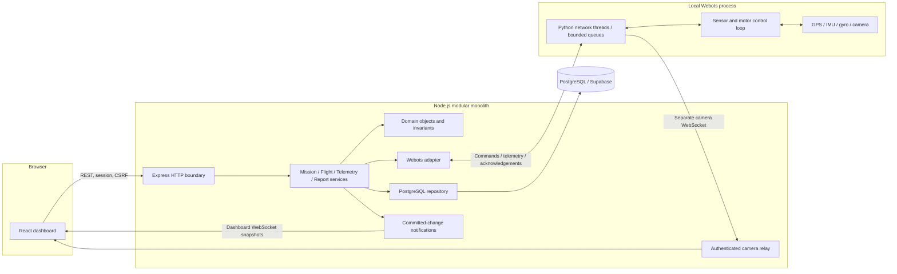
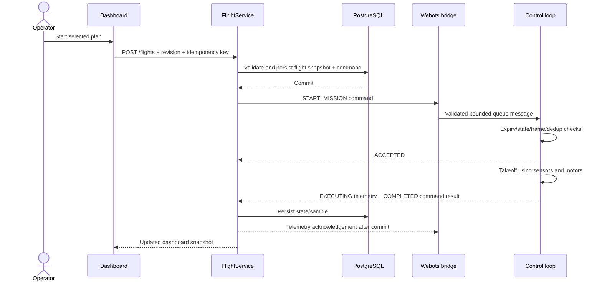
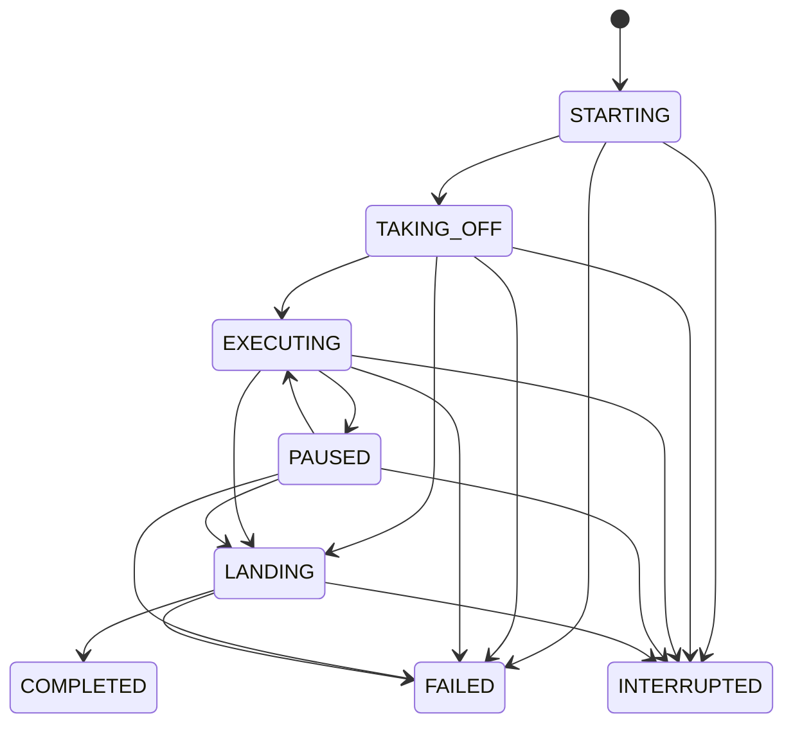
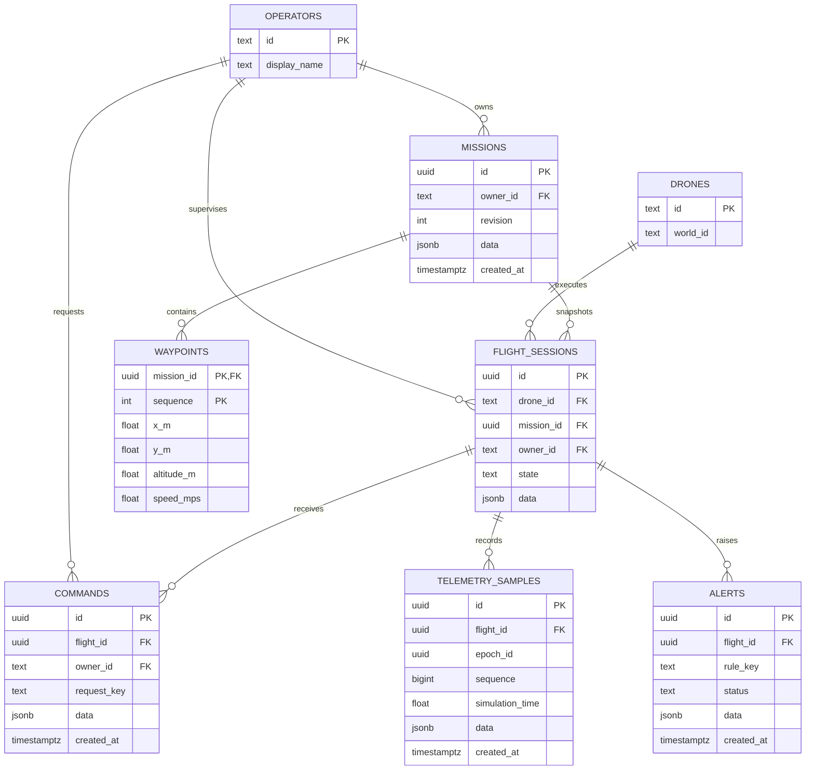
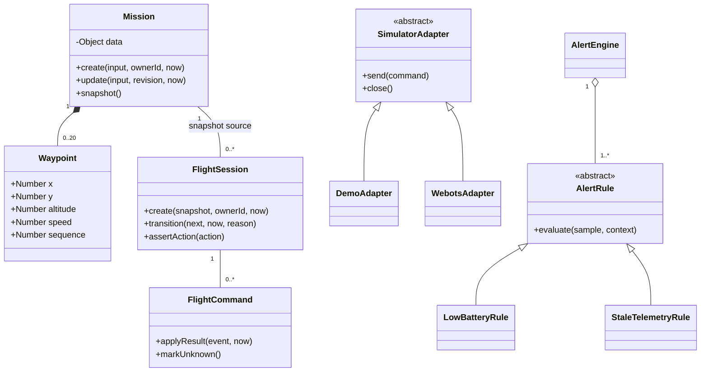
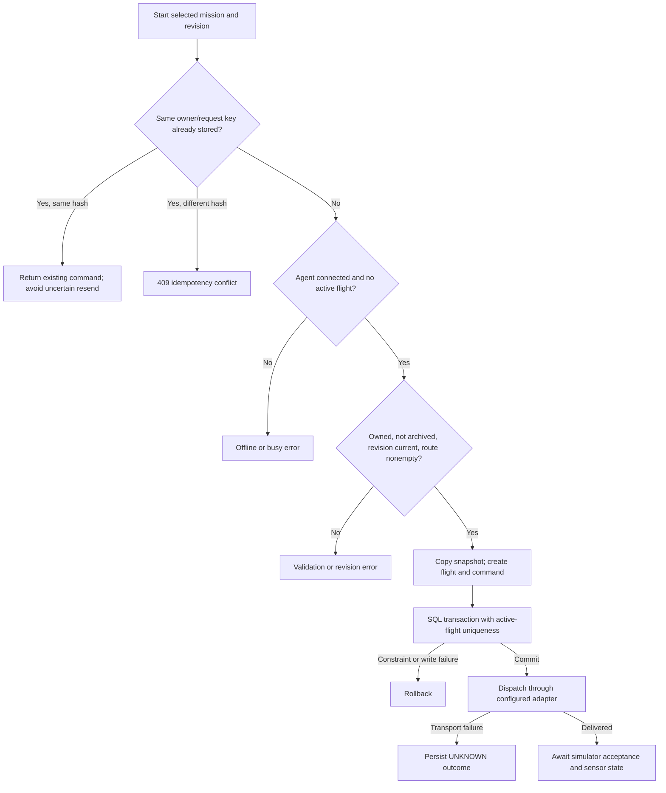
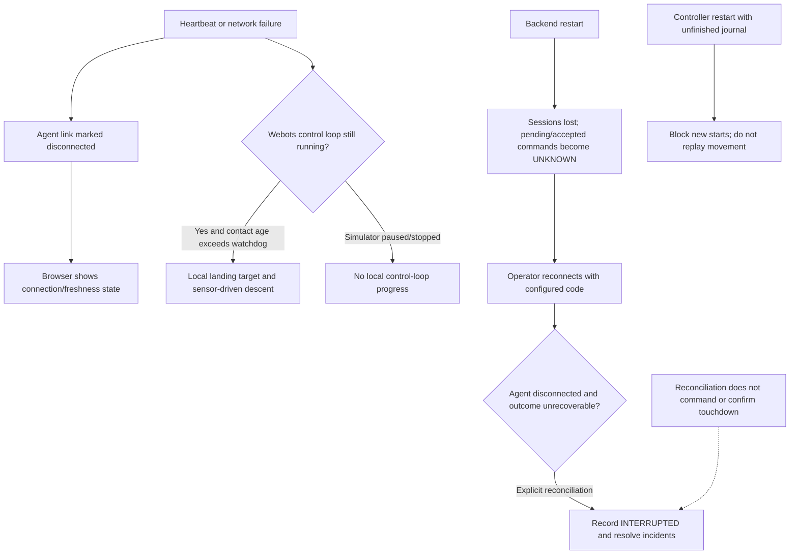
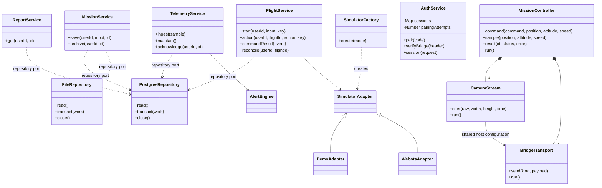

# bumbl.bee

**Drone mission control, live telemetry and flight analytics connected to Webots.**

bumbl.bee is a desktop ground station for planning local-coordinate routes, supervising a simulated quadcopter, viewing its onboard camera and reviewing recorded flights. React renders reported state; an Express backend owns mission and command workflows; a Python controller runs the flight stabilization loop inside Webots. PostgreSQL stores mission revisions, immutable flight snapshots, commands, telemetry and incidents.

The application is implemented and exercised locally with a real Webots controller. It supports one configured drone and one active flight per installation. It is not a physical-drone autopilot or a publicly qualified flight-control service.

## Contents

- [Capabilities](#capabilities)
- [Functional requirements](#functional-requirements)
- [Architecture](#architecture)
- [Local setup](#local-setup)
- [Using the application](#using-the-application)
- [Mission and coordinate contracts](#mission-and-coordinate-contracts)
- [Command lifecycle](#command-lifecycle)
- [Persistence](#persistence)
- [API and streaming interfaces](#api-and-streaming-interfaces)
- [Engineering decisions](#engineering-decisions)
- [Detailed runtime sequences](#detailed-runtime-sequences)
- [Implementation contracts and engineering reference](#implementation-contracts-and-engineering-reference)
- [Verification and limits](#verification-and-limits)
- [Repository guide](#repository-guide)

## Capabilities

| Area | Behavior |
|---|---|
| Flight console | Canonical square map, onboard camera, compass, altitude ruler and eight telemetry tiles |
| Mission planning | Saved-plan library, click/drag waypoints, ordered list, coordinate/altitude/speed editing, save and revision checks |
| Templates | Straight line, Square, Zigzag, Circular, Toroidal up and Toroidal down |
| Mission execution | Start, pause/position hold, resume and land through acknowledged commands |
| Navigation | Rate-limited waypoint-facing yaw; configurable incoming-leg speed with approach slowdown |
| Camera | Authenticated 640×360 JPEG feed, target up to 5 FPS, latest-frame delivery and stale/disconnected states |
| History | Recorded flights, outcomes, duration, route/chart reports, commands, incidents and JSON download |
| System & alerts | Simulator/channel status, configuration and low-battery/stale-telemetry incident acknowledgement |
| Presentation | Light/dark themes; desktop viewport at least 1100×650 CSS pixels; fixed workspace with bounded, scrollbar-free lists |

The camera is a 2D onboard image stream. The 3D world runs in the local Webots application. Battery is synthetic and labelled estimated. Empty charts and pre-flight zero defaults are presentation states, not sensor measurements; missing in-flight readings remain unavailable.

## Functional requirements

| ID | Requirement | Acceptance |
|---|---|---|
| FR-01 | Installation-code entry | Permanent configured four-character code establishes a random protected browser session; invalid attempts are limited |
| FR-02 | Mission library | Saved plan map/title tiles, selection, edit and archive; selection returns to console without starting flight |
| FR-03 | Mission editor | Click/drag and numeric X/Y/altitude/speed editing, ordered list, defaults and revision-checked saving |
| FR-04 | Simulator connection | Separate credential and drone/epoch handshake; offline is explicit and never silently becomes demo |
| FR-05 | Start mission | Immutable mission revision snapshot; one active flight per drone; duplicate requests reconcile |
| FR-06 | Local execution | Webots sensors and motor control execute waypoints without UI-generated motion |
| FR-07 | Pause | Current-position hold, acknowledged result, measured flight state |
| FR-08 | Resume | Continue remaining mission from paused state |
| FR-09 | Land | Current-position descent; completion requires touchdown evidence |
| FR-10 | Telemetry | Position, altitude, ground speed, attitude, battery estimate, waypoint and simulation time |
| FR-11 | Freshness | Connection and stale telemetry remain distinct from flight state; unavailable readings do not imply successful execution |
| FR-12 | Incidents | Low battery and stale telemetry rules, acknowledgement and history |
| FR-13 | History/report | Durable flight overview, charts, route, commands and incidents |
| FR-14 | Export | JSON download of recorded report |
| FR-15 | Failure/recovery | Durable command IDs, expiry, unknown outcomes, epoch/ordering fences and explicit recovery limitations |
| FR-16 | Camera | Separate authenticated latest-frame JPEG transport with waiting/live/stale/disconnected states |
| FR-17 | Speed | Default and incoming-leg speed0.2–2m/s stored in snapshot and validated through controller boundary |
| FR-18 | Templates | Six bounded editable predefined routes; no automatic launch |

## Architecture



### Technology

| Layer | Technology |
|---|---|
| Frontend | React, JavaScript, Vite, Lucide icons, Recharts |
| Backend | Node.js, Express, JavaScript ES modules, Zod, `ws` |
| Database | PostgreSQL, `pg`, versioned SQL migrations; Supabase session pooler supported |
| Simulator | Webots Mavic2Pro model and project Python controller |
| Bridge | Python 3.11, websocket-client 1.8.0, Pillow 11.3.0 |
| Verification | Node test runner, Supertest, PGlite, Vitest/Testing Library, Python unittest |
| Delivery | npm workspaces, lockfile, Dockerfile, GitHub Actions |

Dependencies are pinned in the workspace manifests/lockfile. Node support is `>=24 <27`; Node 24 is the documented baseline. Local simulator evidence used Python 3.11.18 and Webots R2025b Nightly Build 13/11/2026, commit `c85603f2280c68ebdcc0a4102e43026fcbf2bc71`. Other simulator builds need compatibility checks.

### Responsibility boundaries

- **UI:** route editing, selection and rendering; never writes a simulated pose or calculates authoritative flight motion.
- **HTTP/socket boundaries:** authentication, schema validation, origin/CSRF rules and error translation.
- **Application services:** transaction orchestration, idempotency, persistence and committed-change publication.
- **Domain:** route validity, revisions, legal flight transitions and command invariants, independent of Express, PostgreSQL and Webots.
- **Repository:** durable state and SQL integrity. One backend process uses transactions and advisory locking; constraints enforce shared invariants.
- **Webots controller:** stabilization, sensors, motors, arrival/landing checks and local contact-loss response. Network work uses separate threads and bounded queues.

## Local setup

For the complete first-run, terminal-by-terminal launch and troubleshooting guide, see [Running the project](docs/RUNNING.md).

### 1. Install JavaScript dependencies

```sh
git clone git@github.com:mk0904/bumblbee.git
cd bumblbee
npm ci
cp backend/.env.example backend/.env
```

Configure the ignored `backend/.env`:

```dotenv
HOST=127.0.0.1
PORT=3000
APP_ORIGIN=http://127.0.0.1:5174
SIMULATOR_MODE=webots
SIMULATOR_TOKEN=<long-random-host-side-credential>
DATABASE_URL=<postgresql-connection-string>
# For the Supabase provider CA, relative to backend/:
# DATABASE_CA_CERT=certs/supabase-root-2021.crt
```

Generate a credential locally, for example with `openssl rand -hex 32`. Never place database passwords or the simulator credential in React or a `VITE_` variable. The browser does not query Supabase tables directly; Express uses the trusted database connection. Supabase's publishable browser key is not required for this architecture.

Use verified database TLS. The public provider certificate is under `backend/certs/`; it is not a private key. Direct database or session-pooler connectivity depends on the local network. Configure the connection supplied by your database provider.

### 2. Initialize PostgreSQL

```sh
npm run db:migrate
```

Migrations create the base schema and add per-waypoint speed. Existing volumes must be migrated rather than deleted. `docker compose up -d` provides an optional local PostgreSQL service; configure `DATABASE_URL` to match that service and its development credentials.

### 3. Start dashboard and backend

```sh
npm run dev
```

Open **http://127.0.0.1:5174/**. The backend listens on **127.0.0.1:3000**; Vite proxies `/api` and `/ws`. Keep the terminal running. If only one service needs restarting, use `npm run dev:backend` or `npm run dev:frontend`.

### 4. Start Webots

Install the compatible Webots application, then create the controller environment:

```sh
python3.11 -m venv simulator/.venv
simulator/.venv/bin/pip install -r simulator/requirements.txt
./simulator/run-webots.sh
```

The launcher defaults to the macOS Webots executable and port 1250. Override `WEBOTS_EXECUTABLE` for another installation. It prepends the Python virtual environment to `PATH`. The controller reads host-side configuration from `backend/.env`; the server and bridge need matching credentials and a reachable backend URL. See [simulator setup](simulator/README.md).

### 5. Connect and load templates

The configured four-character code is **BMBL**, stored in `shared/config/drone.json`. It is permanent and reusable for this installation. Enter it on the launch screen. Other installations configure their own code; this does not enable multiple simultaneous drones on one backend.

To create the six built-in plans in the current repository:

```sh
node --env-file=backend/.env scripts/seed-mission-templates.js
```

The script skips existing matching names. It saves plans through authenticated APIs and does not start a flight.

### Optional demo mode

Set `SIMULATOR_MODE=demo` and restart the backend to use the labelled kinematic adapter without Webots. Without `DATABASE_URL`, local-file demo storage is available. Demo motion is application-test behavior, not physical flight evidence. The application does not silently substitute demo mode when Webots is offline.

## Using the application

1. Open Mission planner. Select a saved tile to preview it on the console, or use its edit icon to load it in the editor.
2. Name the route and choose default altitude and speed. Click the map to add waypoints, drag markers to move them, or edit their values in the list.
3. Adjust each point's altitude and incoming-leg speed; reorder/remove points using its action tray. Save the mission.
4. Select the saved plan to return to the console. Selection does not start flight.
5. With Webots connected, start the selected mission. Pause holds the current position; Resume continues the route; Land descends at the current location. Normal route completion lands at the final point.
6. Inspect measured telemetry, camera and freshness. The compass uses local north (+Y), not a geographic or magnetic sensor.
7. Review the flight report and command outcomes in Flight history. System & alerts contains incidents and connection details.

Map controls support wheel/trackpad pinch, zoom buttons and reset. Flight-console zoom survives screen switches within the browser tab. Saved-plan and waypoint lists scroll within their panels; the page remains fixed.

## Mission and coordinate contracts

| Parameter | Contract |
|---|---|
| World / frame | `training-ground-v1` / `WORLD_LOCAL_V1` |
| Geometry | Webots ENU: X/Y horizontal, Z up; pad surface is Z=0 |
| Surface | 120×120 m; canonical texture shared by simulator and dashboard |
| Flight bounds | X and Y each within −50…50 m |
| Waypoints | 1–20 to fly; empty routes may be saved as drafts |
| Altitude | 2–15 m |
| Speed | 0.2–2 m/s; legacy unspecified speed resolves to 1 m/s |
| Defaults | New points inherit the current defaults; existing points are not overwritten |
| Speed semantics | Waypoint speed caps the desired horizontal approach velocity for the leg ending there |
| Heading | Slew-limited toward the next waypoint while executing; held during pause/landing |

Speed is a setpoint cap, not exact ground-speed tracking. Acceleration limits and approach slowdown affect the measured speed. Toroidal up/down are waypoint approximations of two-turn ascending/descending helices, from 3 to 11 m or the reverse; they are not full torus-surface trajectories.

Mission revisions prevent stale edits. Starting a flight copies the mission into an immutable execution snapshot: later edits cannot alter an ongoing flight.

## Command lifecycle



The start **command** completes when mission execution begins. The **flight** completes only after landing evidence.



Connection freshness is separate from flight state. Command acceptance expires after 10 seconds; accepted outcomes have a separate timeout. Timeout means **UNKNOWN**, not automatic rejection or proof that the drone stopped. Late definitive outcomes are reconciled under state/flight fencing. Backend restarts do not blindly replay uncertain movement.

The bridge journals command IDs and flight activity in local SQLite. An unfinished local flight after controller restart blocks new starts pending reconciliation. Exactly-once execution across crashes is not claimed.

## Persistence



Relational keys and checks protect structure; JSONB retains complete aggregate records and snapshots. Important constraints/indexes:

- One nonterminal flight per drone: partial unique index.
- Command request deduplication: unique `(owner_id, request_key)` with payload-hash conflict checks.
- Telemetry deduplication: unique `(flight_id, epoch_id, sequence)`; ordered ingestion prevents older samples replacing current state.
- One unresolved alert per flight/rule: partial unique index.
- Ordered waypoints: composite `(mission_id, sequence)` key, coordinate/altitude/speed checks.
- Indexed history and timelines for flights, commands, telemetry and alerts.

RLS is enabled without public browser-client policies. The trusted server connection owns data access. Camera frames are transient and are not saved to PostgreSQL or included in reports.

## API and streaming interfaces

All paths below are prefixed with `/api`. Mutating operator requests require the session, matching Origin and CSRF token; flight command mutations also use an idempotency key.

| Method | Path | Purpose |
|---|---|---|
| GET | `/health` | Backend health |
| GET | `/auth/config` | Available entry mode |
| POST | `/pairing/request` | Bridge-authenticated configured code response |
| POST | `/pairing/claim` | Exchange installation code for protected browser session |
| GET / POST | `/auth/me`, `/auth/logout` | Session inspection / revocation |
| GET | `/dashboard` | Operator-scoped missions, flights, commands, telemetry and incidents |
| POST | `/missions` | Save a new plan |
| PATCH / DELETE | `/missions/:id` | Revision-checked update / archive |
| POST | `/flights` | Start from mission ID and revision |
| POST | `/flights/:id/commands` | Pause, resume or land |
| POST | `/flights/:id/reconcile` | Close an unconfirmed flight under recovery rules |
| GET | `/flights/:id/report` | Saved flight analysis and records |
| POST | `/alerts/:id/acknowledgement` | Acknowledge an incident |
| POST | `/demo/inject` | Development demo fault injection only |

A mission payload includes `name`, `defaultAltitude`, `defaultSpeed` and ordered `waypoints` with `x`, `y`, `altitude`, `speed`. Updates include `revision`. Boundary errors use structured responses and appropriate validation/auth/conflict codes.

| WebSocket | Authentication / responsibility |
|---|---|
| `/ws/dashboard` | Browser session + Origin; current committed snapshots |
| `/ws/simulator` | Host-side bearer credential + drone/epoch handshake; commands, heartbeats, telemetry |
| `/ws/camera/producer` | Simulator credential and active epoch; bounded JPEG frames |
| `/ws/camera/viewer` | Browser session + Origin; latest frame, no durable replay |

See [protocol details](contracts/protocol.md) and [REST reference](contracts/openapi.json). The source schemas in `backend/src/interfaces/http/create-app.js` are the executable request contract.

## Engineering decisions

| Decision | Rationale / implementation |
|---|---|
| Modular monolith | One process is sufficient for a single-drone installation and keeps transactions and socket ownership explicit |
| Plain JavaScript | Shared language for browser/backend; JSDoc, runtime validation and tests express boundary contracts |
| Domain encapsulation | `Mission`, `FlightSession` and `FlightCommand` enforce invariants instead of route handlers |
| Dependency inversion | Services receive repository/gateway dependencies; infrastructure does not dictate domain rules |
| Strategy | `AlertEngine` evaluates independent low-battery and stale-telemetry rules |
| Factory and adapter | `SimulatorFactory` selects demo/Webots implementations behind the same adapter contract |
| Observer | Committed service changes notify dashboard subscribers through backend events |
| Composition | Mission owns waypoint values; services compose repositories, gateways and rules |
| Immutable execution | Flights retain their route/settings snapshot despite later mission edits |
| Separate camera transport | Frame backpressure must not block supervisory commands or motor control |
| Canonical shared map | Same geometry/texture and coordinate conversion in Webots and every UI map |
| Permanent four-character code | Explicit local-installation usability choice; reusable code with rate-limited claims and separate random sessions |

### Object relationships



Design patterns are used where behavior requires them; the project does not introduce a Singleton, microservice or broker merely to demonstrate a pattern count. Detailed historical decisions are in [docs/decisions](docs/decisions).

### Authentication scope

BMBL is a short shared access code, not a strong secret. Claims are rate-limited and create random HttpOnly browser sessions with CSRF/Origin protections. Sessions expire after eight hours and are not persisted across backend restarts; the same code reconnects afterward. The simulator authenticates separately using its host-side credential. This local capstone access model needs stronger authorization before exposure to untrusted public users.

## Detailed runtime sequences

These diagrams describe the current service methods and simulator behavior, rather than the earlier project-construction workflow. Error branches omit repetitive response serialization, not validation or persistence.

### Installation-code entry and session lifecycle

```mermaid
sequenceDiagram
  actor Operator
  participant UI as Pairing screen
  participant HTTP as Express
  participant Auth as AuthService
  Operator->>UI: Enter configured code
  UI->>HTTP: POST /pairing/claim with Origin
  HTTP->>HTTP: Per-client rate limit and input validation
  HTTP->>Auth: pair(code)
  Auth->>Auth: Guess budget and configured-code comparison
  alt Incorrect code or exhausted budget
    Auth-->>UI: 401 invalid code / 429 rate limit
  else Valid reusable code
    Auth->>Auth: Generate random session and CSRF tokens
    Auth-->>HTTP: Session token, user and CSRF
    HTTP-->>UI: HttpOnly cookie + user/CSRF response
    UI->>HTTP: GET /dashboard with cookie
    HTTP->>Auth: session(request)
    HTTP-->>UI: Authorized snapshot
  end
  Note over Auth: Code is permanent; sessions expire after 8 hours
  Operator->>UI: Disconnect
  UI->>HTTP: POST /auth/logout + CSRF
  HTTP->>Auth: Revoke session
  HTTP-->>UI: Clear cookie
```

The configured code is not fetched through an unauthenticated “show code” endpoint. `/pairing/request` remains bridge-authenticated. The code itself is checked from installation configuration and does not require the bridge to issue a new one on each visit.

### Mission save, revision conflict and selection

```mermaid
sequenceDiagram
  actor Operator
  participant UI as Planner / Workspace
  participant HTTP as HTTP boundary
  participant Service as MissionService
  participant Domain as Mission / Waypoint
  participant Repo as Repository
  Operator->>UI: Edit title, defaults and route
  UI->>HTTP: POST or PATCH /missions with CSRF and revision
  HTTP->>HTTP: Validate finite DTO fields and speed range
  HTTP->>Service: save(userId, input, optional id)
  Service->>Repo: transact(work)
  Repo->>Domain: Create or update owned mission
  Domain->>Domain: Revision, name, bounds, altitude, speed validation
  alt Invalid or stale revision
    Domain-->>Repo: DomainError
    Repo-->>HTTP: Rollback, return validation/conflict
    HTTP-->>UI: Error; editor values retained
  else Valid
    Domain-->>Repo: Copied mission record
    Repo->>Repo: Write mission and normalized waypoints atomically
    Repo-->>Service: Commit
    Service-->>UI: Changed snapshot and saved response
  end
  Operator->>UI: Click saved tile
  UI->>UI: Store selected mission ID and return to console
  Note over UI: Selecting does not dispatch a movement command
```

### Mission validation and concurrent-start activity



The repository's transaction-scoped advisory lock serializes this scoped workload; the partial unique index independently prevents two nonterminal flights for the drone. The HTTP response does not establish takeoff or motor execution.

### Pause, resume and early land

```mermaid
sequenceDiagram
  actor Operator
  participant UI as Console
  participant Service as FlightService
  participant Repo as Repository
  participant Bridge as Webots bridge
  participant Loop as MissionController
  Operator->>UI: Pause / Resume / Land
  UI->>Service: action(userId, flightId, action, key)
  Service->>Repo: Validate owner, connection, legal state and pending command
  alt Land supersedes pending start
    Repo->>Repo: Cancel start command with reason
  else Conflicting pending command
    Repo-->>UI: Reject conflict
  end
  Repo-->>Service: Commit new command
  Service->>Bridge: Send identified command
  Bridge->>Loop: Queue validated request
  Loop->>Loop: Check expiry, journal and legal state
  Loop-->>Service: ACCEPTED
  alt Pause
    Loop->>Loop: Capture current position and yaw; hold
    Loop-->>Service: PAUSED telemetry and completed command
  else Resume
    Loop->>Loop: Restore waypoint execution
    Loop-->>Service: EXECUTING telemetry and completed command
  else Land
    Loop->>Loop: Descend at current position
    Loop-->>Service: LANDING telemetry
    Loop->>Loop: Check low altitude and settled motion
    Loop-->>Service: COMPLETED telemetry and landing command result
  end
  Service->>Repo: Persist reported outcomes
  Service-->>UI: Committed snapshot
```

The controller journal prevents a repeated ID from repeating movement. Pause/resume completion records the mode transition; landing completion waits for touchdown criteria. The controller's command validation remains authoritative even if the browser's disabled-state checks are bypassed.

### Telemetry persistence, ordering and incident evaluation

```mermaid
sequenceDiagram
  participant Loop as Webots control loop
  participant Bridge as BridgeTransport
  participant Socket as Simulator socket boundary
  participant Telemetry as TelemetryService
  participant Repo as PostgreSQL repository
  participant Rules as AlertEngine
  participant UI as Dashboard socket
  Loop->>Bridge: Sensor sample / state event
  Bridge->>Bridge: Bounded queue; one sample awaiting ACK
  Bridge->>Socket: Telemetry with flight, epoch, sequence and simulation time
  Socket->>Socket: Schema, size, active epoch and queue checks
  Socket->>Telemetry: ingest(sample)
  Telemetry->>Repo: transact(work)
  Repo->>Repo: Duplicate, flight, time and epoch validation
  alt Newer sequence
    Repo->>Repo: Legal state transition and latest update
    Repo->>Rules: Evaluate battery / freshness rules
    Rules-->>Repo: Incident decisions
    Repo->>Repo: Create/resolve incidents
  else Older valid sequence
    Repo->>Repo: Preserve history without replacing latest
  end
  Repo-->>Telemetry: Commit
  Telemetry-->>UI: Publish committed change / fresh snapshot
  Socket-->>Bridge: telemetry_ack after persistence
```

Duplicate samples are ignored; nonmonotonic simulation-time/sequence relationships and foreign epochs are rejected. State-changing events are retained by the bridge while ordinary same-state samples can coalesce. Heartbeat acknowledgements are separate and do not prove telemetry persistence.

### Incident maintenance and acknowledgement

```mermaid
sequenceDiagram
  participant Timer as Runtime maintenance timer
  participant Service as TelemetryService
  participant Rules as AlertEngine
  participant DB as Repository
  actor Operator
  Timer->>Service: maintain() approximately every second
  Service->>DB: Transaction over active flights and pending commands
  Service->>Rules: Evaluate latest reading and age
  Rules-->>Service: Low-battery / stale decisions
  Service->>DB: Create or resolve incident; time out command to UNKNOWN
  DB-->>Service: Commit
  Operator->>Service: acknowledge(userId, alertId) through protected API
  Service->>DB: Check ownership; OPEN to ACKNOWLEDGED
  DB-->>Service: Commit and notify dashboard
```

Acknowledgement records operator awareness; it does not repair the fault or resolve the incident. A rule no longer firing or a terminal flight resolves applicable records. Database partial uniqueness prevents duplicate unresolved rule incidents.

### Camera capture and bounded media relay

```mermaid
sequenceDiagram
  participant W as Webots main thread
  participant C as CameraStream worker
  participant N as Node camera channel
  participant U as CameraFeed
  U->>N: Viewer connection with cookie and Origin
  C->>N: Producer credential and active drone epoch
  W->>C: Copied BGRA buffer; replace older queued image
  C->>N: 640x360 JPEG envelope
  N->>N: Check epoch, sequence, JPEG dimensions, bytes and rate
  N-->>U: Latest frame; skip slow consumer socket
  N-->>C: Frame ACK
  Note over W,N: Independent from command/telemetry socket and motor loop
  N-->>U: Waiting, stale or disconnected status as appropriate
```

The frame is validated as JPEG, not trusted from its claimed metadata alone. Producer frames are limited to 150KB decoded JPEG, 200,000 base64 characters and up to5FPS; socket payload limit is210KB. Viewer buffers above300KB are skipped. Silence beyond3seconds marks the feed stale. Frames are not persisted.

### Flight reports and export

```mermaid
sequenceDiagram
  actor Operator
  participant UI as History / Report
  participant HTTP as HTTP boundary
  participant Service as ReportService
  participant Repo as Repository
  Operator->>UI: View report
  UI->>HTTP: GET /flights/:id/report
  HTTP->>Service: get(userId, id)
  Service->>Repo: read()
  Repo-->>Service: Flight, telemetry, commands and alerts
  Service->>Service: Check ownership and sort samples by simulation time
  Service->>Service: Detect sequence gaps; aggregate summary
  Service-->>UI: Report DTO
  UI->>UI: Show map, chart, outcomes and completeness warnings
  Operator->>UI: Download report
  UI->>UI: Serialize DTO as local JSON download
```

Report duration is the difference between first/last recorded simulation timestamps. Distance sums 3D displacement only across consecutive same-epoch samples; gaps are counted rather than bridged with invented distance. Maximum altitude uses recorded readings; battery used is the synthetic first-minus-last reading. `complete` requires a COMPLETED flight and no detected sequence gaps; it is not a certification of navigation accuracy.

### Disconnects, restart and unknown outcome



## Implementation contracts and engineering reference

### Application service signatures

These are JavaScript method contracts, not additional HTTP endpoints:

| Service | Methods |
|---|---|
| MissionService | `save(userId, input, id?)`, `archive(userId, id)` |
| FlightService | `start(userId, {missionId, revision}, key)`, `action(userId, flightId, action, key)`, `commandResult(event)`, `reconcile(userId, flightId)` |
| TelemetryService | `ingest(sample)`, `maintain()`, `acknowledge(userId, id)` |
| ReportService | `get(userId, id)` |
| Repository | `init()`, `read()`, `transact(work)`, `close()` |
| AuthService | `verifyBridge(header)`, `requestPairing()`, `pair(code)`, `issueSession()`, `session(request)`, `logout(request)` |

Repository `transact` supplies isolated mutable state and commits the result atomically or rolls back. PostgresRepository currently loads the aggregate state with one consistent SQL statement and diffs records for writes. This is appropriate to the scoped single-process installation, not an incremental high-volume telemetry store; large histories require repository/query redesign.

### Complete service and infrastructure relationships



Repository arrows indicate injected port dependencies, not ownership or mandatory use of PostgreSQL in demo mode. Snapshot, telemetry and alert records are validated plain records rather than invented domain classes. AuthService's four-character code comes from installation configuration; it no longer maintains a collection of expiring pairing codes.

### Persisted record fields

| Record | Main fields |
|---|---|
| Mission | id, ownerId, revision, name, optional legacy description, defaultAltitude, defaultSpeed, waypoints, worldId, frame, archived, timestamps |
| Waypoint | x, y, altitude, speed, sequence |
| Flight | id, droneId, missionId, ownerId, snapshot, adapter, state, startedAt, endedAt, reason, latest |
| Command | id, flightId, ownerId, action, requestKey, requestHash, status, createdAt, expiresAt, acceptedAt, completedAt, error |
| Telemetry | id, flightId, epochId, sequence, simulationTime, receivedAt, x/y/altitude, speed, roll/pitch/yaw, battery/source, waypoint, state, reason |
| Incident | id, flightId, ruleKey, severity, title/message, status, createdAt, acknowledgedAt, resolvedAt |

### Error and concurrency behavior

| Trigger | Behavior |
|---|---|
| Invalid JSON/shape/nonfinite fields | Reject at interface boundary; domain also checks meaningful invariants |
| Invalid route/speed or empty-flight route | Validation error; no movement dispatched |
| Stale mission revision |409; preserve editor rather than overwrite another revision |
| Reused idempotency key with different payload |409 conflict |
| Offline simulator | Start/action rejected; never simulated in UI |
| Concurrent starts | Transaction/active-flight unique index allows only one |
| Pending command conflict | Reject except supported early landing superseding pending start |
| Send failure or elapsed command deadline | UNKNOWN; no automatic movement replay |
| Duplicate/older sample | Duplicate ignored; valid older history cannot replace latest |
| New epoch on ongoing flight | Requires explicit reconciliation |
| Slow camera/dashboard client | Bounded/skip or disconnect behavior; no unlimited queue |
| Expired/revoked browser session | HTTP access rejected; live sockets closed by session checks |
| Database failure | Transaction rollback; telemetry ACK is not issued as committed evidence |

### SDSE traceability

| Rubric | Implemented artifact |
|---|---|
| Requirements and actors | Capabilities/envelope and docs/PRD.md FR table |
| Class diagram and relationships | Domain and infrastructure class diagrams above |
| OOP | Private aggregate state, immutable exports/value objects, genuine adapter/rule inheritance |
| SOLID | Domain/service/IO separation; injected repositories/gateways; independent incident strategies and adapter contracts |
| Design patterns | Factory, Adapter, Strategy, Observer and identified command lifecycle |
| Sequence/activity diagrams | Entry, save, start, control, telemetry, incidents, camera, reports and recovery diagrams |
| API/interfaces | REST/socket inventory, method signatures and source boundary schemas |
| Schema/indexes | ER diagram, migrations and constraint/index table |
| Errors/concurrency | Error table, idempotency, revision checks, SQL transaction/constraint tests |
| Working implementation | Automated checks plus retained real Webots/camera trials and their limits |

The single-responsibility boundary is visible in domain, use-case, authentication and persistence classes. Open/closed behavior is demonstrated by injected alert strategies and configured adapters. Substitution is supported by contract tests, while demo physics is explicitly not treated as equivalent to Webots. Interface segregation uses small repository/gateway contracts; dependency inversion is wired by `createRuntime`.

### Timing and bounds reference

| Boundary | Current value / semantics |
|---|---|
| Physics step |8ms in the shipped world |
| Generated telemetry |Approximately2Hz plus state-change samples; persistence-limited delivery |
| Bridge liveness |Heartbeat approximately1s; server disconnect check after5s without liveness |
| Local contact-loss response |Controller changes to LANDING after transport failure or more than5s since acknowledgement, while loop runs |
| Stale telemetry/camera |More than3s since latest received reading/frame |
| Low-battery rule |Synthetic battery at or below20% |
| Command acceptance window |10s |
| Accepted outcome deadline |60s after acceptance; unresolved becomes UNKNOWN |
| Browser session |8h maximum; in-memory, revoked by logout/restart |
| HTTP JSON body |64KB |
| Simulator ingress work |Bounded queue; overload closes rather than accumulating unlimited work |

### Decision register

| Record | Current relevance |
|---|---|
| [ADR-001](docs/decisions/ADR-001-foundation.md) |Foundation and JavaScript modular architecture |
| [ADR-002](docs/decisions/ADR-002-dashboard-first.md) |Historical dashboard-first delivery order, not an outstanding integration gate |
| [ADR-003](docs/decisions/ADR-003-pairing-and-supabase.md) |Backend-owned PostgreSQL access; temporary-code policy superseded by ADR-014 |
| [ADR-004](docs/decisions/ADR-004-console-ui.md) |Instrument-focused console, subsequently refined by current UI |
| [ADR-005](docs/decisions/ADR-005-webots-training-world.md) |Local world and observed Webots compatibility |
| [ADR-006](docs/decisions/ADR-006-desktop-viewport.md) |Desktop/fixed-page boundary; later direction permits bounded list scrolling |
| [ADR-007](docs/decisions/ADR-007-webots-executor.md) |Sensor executor, durable journal, persistence ACK and uncertainty |
| [ADR-008](docs/decisions/ADR-008-onboard-camera.md) |Independent ephemeral media channel |
| [ADR-009](docs/decisions/ADR-009-textured-yard.md) |Textured yard rendering |
| [ADR-010](docs/decisions/ADR-010-canonical-yard-map.md) |Shared, physically scaled world/map atlas |
| [ADR-011](docs/decisions/ADR-011-simultaneous-flight-views.md) |Simultaneous map, camera and telemetry |
| [ADR-012](docs/decisions/ADR-012-route-heading.md) |Waypoint-facing yaw and local compass convention |
| [ADR-013](docs/decisions/ADR-013-display-identity-selection.md) |Explicit route selection; display-only code policy superseded by ADR-014 |
| [ADR-014](docs/decisions/ADR-014-permanent-drone-code.md) |Reusable short installation code and its security tradeoff |
| [ADR-015 speed](docs/decisions/ADR-015-mission-leg-speed.md) |Default and incoming-leg speed, SQL migration and controller semantics |
| [ADR-015 theme](docs/decisions/ADR-015-light-theme.md) |Light/dark appearance; historical number collision distinguished by filename |

The README consolidates current technical material from requirements, engineering notes, implementation records and ADRs. Archived chronology remains available for provenance; obsolete proposals are not presented as implemented capabilities. Evidence files retain both successful and failed trial outcomes.

## Verification and limits

Run application checks:

```sh
npm run check
simulator/.venv/bin/python3 -m unittest discover -s simulator/tests
npm run doctor
```

With an idle, connected Webots agent, run an actual flight acceptance workflow:

```sh
node --env-file=backend/.env scripts/test-webots.js
# Additional route-heading or speed-setpoint checks:
node --env-file=backend/.env scripts/test-webots.js --yaw
node --env-file=backend/.env scripts/test-webots.js --speed
```

These commands move the simulated drone, create test missions and save flight reports. Do not run them alongside another operator flight. `scripts/test-camera.js` checks live frame delivery separately.

Coverage includes domain transitions, mission validation, request deduplication, conflicting starts, SQL constraints/rollback, socket authentication/epoch/order handling, camera payload validation and queue bounds, UI workflows, theme behavior, waypoint templates and Python heading/speed policy.

Recorded local evidence includes successful takeoff/pause/resume/landing, sensor-confirmed touchdown, yaw changing to about 31.7°, and a speed-configured short flight. A local camera observation measured approximately 4.78 FPS over 45 seconds. These are observed trials, not universal performance guarantees; see [evidence](docs/evidence).

Known operational boundaries:

- One drone, one backend worker, no multi-tenant authorization or shared session store.
- No physical drone/MAVLink/PX4 support, collision avoidance, GIS, ML, recording of camera video or browser 3D streaming.
- No automatic uncertain-flight recovery across backend/controller restarts.
- Earlier local measurements showed command acceptance around 1.77–2.20 seconds and persisted telemetry around 0.78 Hz. Generated telemetry targets 2 Hz but database acknowledgement/backpressure can reduce delivery. Fast NFR targets are not established guarantees.
- Templates have boundary tests but have not each been flight-qualified. Speed is conservative; exact-speed and multi-leg transition accuracy require broader qualification.
- Local contact-loss landing and attitude guards exist; intentional network-fault and restart scenarios still need broader physical validation. Pausing the Webots simulation freezes the control loop itself.
- Production-like HTTPS/WSS hosting, network/load tests and broad platform compatibility are not established by local evidence.

### Deployment shape

`npm run build` produces frontend assets; `npm start` launches the backend, which also serves `frontend/dist`. Production configuration requires PostgreSQL, an HTTPS `APP_ORIGIN`, a long simulator token and Webots mode. Apply migrations first and use hosting that supports long-lived WebSockets. The supplied Dockerfile packages one Node service; it does not host Webots. The permanent short-code policy remains a public-deployment limitation even when production configuration checks pass.

## Repository guide

```text
backend/src/domain/                  Mission, flight, command and alert rules
backend/src/application/             Use-case services and report generation
backend/src/infrastructure/          Repositories, auth, runtime and adapters
backend/src/interfaces/              HTTP, dashboard/simulator and camera sockets
backend/migrations/                  Versioned PostgreSQL schema
frontend/src/features/               Console, planner, history/workspace and report UI
frontend/src/components/             Maps, camera, charts, modal and shared controls
shared/config/drone.json             Installation identity/code
shared/worlds/                       Canonical world manifest and texture
shared/mission-templates.js           Six bounded route templates
simulator/controllers/mission_control/ Physics controller, network transport and image queue
simulator/worlds/                    Webots world
scripts/                            Startup, migration, seed and integration utilities
contracts/                          REST and WebSocket documentation
```

Additional documentation:

- [Requirements](docs/PRD.md)
- [Engineering reference and rubric mapping](docs/ENGINEERING.md)
- [Implementation reference](docs/IMPLEMENTATION.md)
- [Operational verification checklist](docs/BUILD_PLAN.md)
- [Simulator setup and attribution](simulator/README.md)
- [Architecture decisions](docs/decisions)
- [Historical development archive](docs/archive/README.md)

Webots model licensing and controller attribution are preserved in the simulator README and controller `LICENSE`/`NOTICE`. Generated launch artwork is a decorative project asset, not simulator footage.
