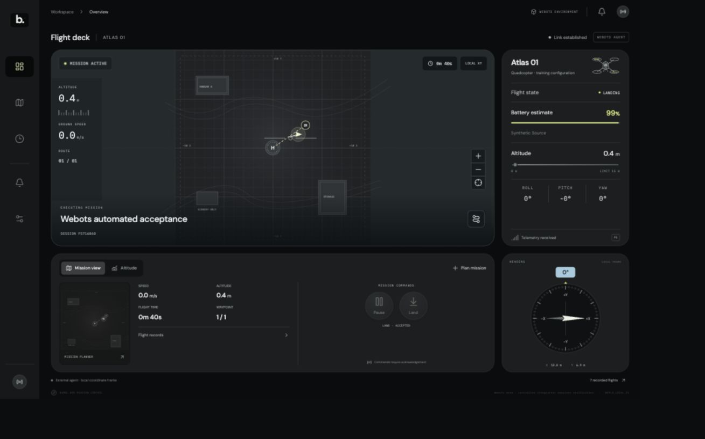
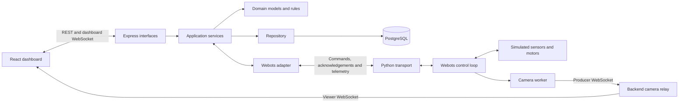
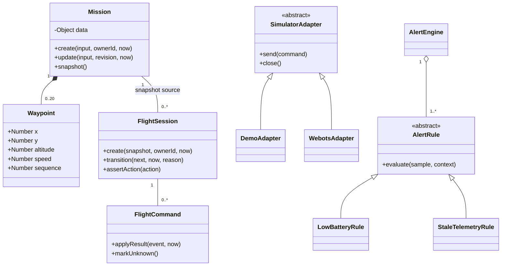
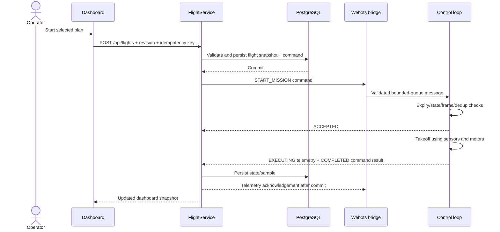
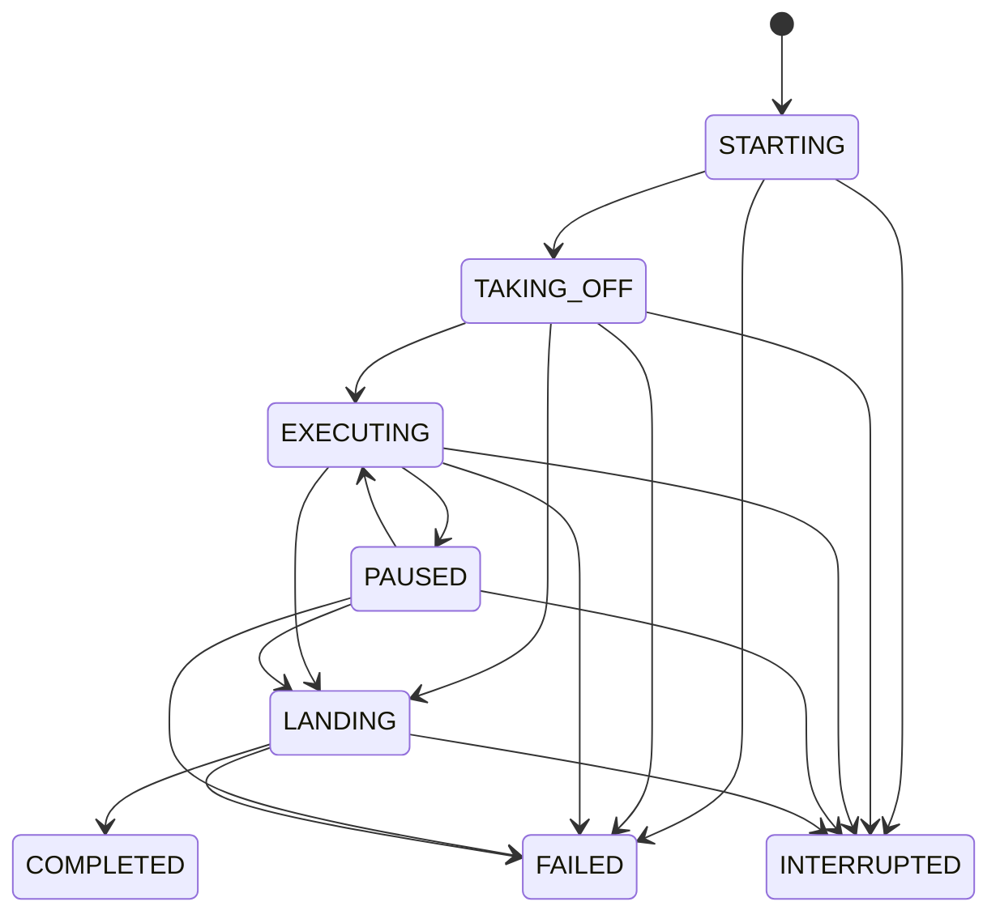
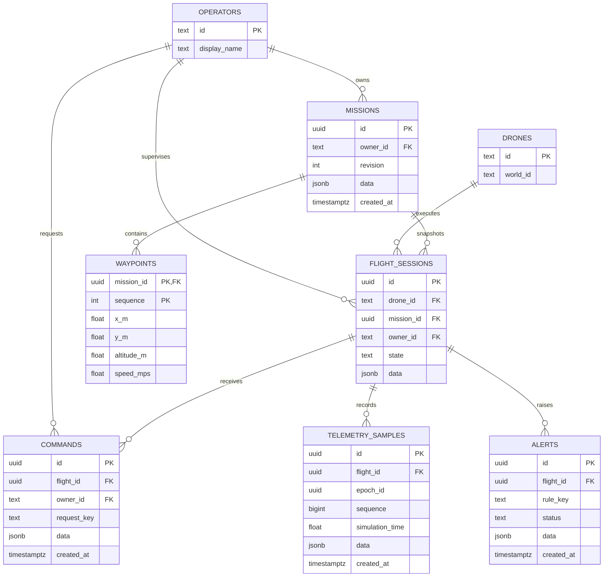
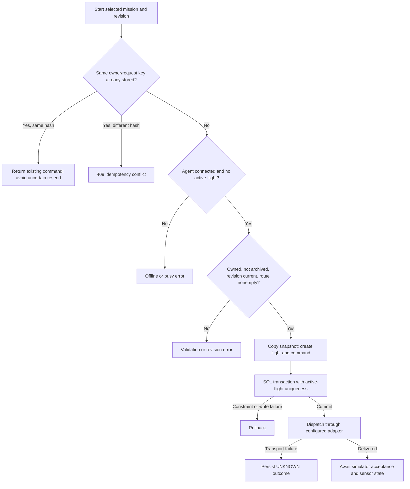

<div align="center">

# 🐝 bumbl.bee

**Plan missions. Observe telemetry. Understand every flight.**

A local drone mission-control platform built with React, Express, PostgreSQL and Webots.


[Getting started](#-getting-started) · [Architecture](#-architecture) · [Engineering design](#-engineering-design) · [Verification](#-verification) · [Documentation](#-documentation)

</div>

---

## 🎯 The problem

A simulated drone flight involves more than drawing a route: an operator needs to plan a mission, send commands, distinguish a connected simulator from a flying aircraft, observe what the drone actually reports, and review what happened afterward. These pieces must remain understandable even when a command times out or telemetry goes stale.

**bumbl.bee** brings those workflows together in a desktop ground station. The dashboard plans and supervises; the backend validates and records; a Python controller in Webots reads sensors and drives the simulated motors. The project is also a practical demonstration of object-oriented design, low-level design, system boundaries, persistence and testable contracts.

> [!IMPORTANT]
> This is a local, single-drone simulation project, not a physical-drone autopilot or a qualified public flight-control service. The demo adapter is useful for exploring the application but does not demonstrate Webots physics.



*Recorded local Webots dashboard view. See [evidence](docs/evidence/) for flight reports, camera checks and additional screenshots.*

## ✨ What you can do

| Workspace | Capabilities |
| --- | --- |
| 🗺️ **Mission planning** | Create and revise local-coordinate routes, place or drag waypoints, edit altitude and incoming-leg speed, and select from six editable templates. |
| 🚁 **Flight supervision** | Start a saved mission and request pause, resume or landing; view command outcomes and simulator connection status. |
| 📡 **Live observation** | View position, attitude, speed, altitude, a battery estimate, a shared yard map and the onboard camera feed. |
| 📊 **Flight history** | Inspect recorded routes, charts, commands and incidents, and export a report as JSON. |
| 🔔 **System and alerts** | Inspect connection information and acknowledge low-battery or stale-telemetry incidents. |

The dashboard supports light and dark themes and is designed for a desktop viewport of at least **1100 × 650 CSS pixels**. The camera is a 2D image feed; the 3D simulation is displayed in Webots. Battery values are synthetic estimates.

## 🧭 Architecture



The backend is a **modular monolith** running as one process. The browser renders reported state; it does not move the drone. Webots owns sensor access, motor control and stabilization. Network and image work run outside the control loop using bounded queues. PostgreSQL stores missions, flight snapshots, commands, telemetry and incidents; an explicitly labelled local-file fallback is available for demo mode.

| Layer | Technology |
| --- | --- |
| Frontend | React, JavaScript, Vite, Recharts, Lucide |
| Backend | Node.js, Express, JavaScript ES modules, Zod, WebSockets (`ws`) |
| Persistence | PostgreSQL, `pg`, versioned SQL migrations; Supabase session pooler supported |
| Simulation | Webots, Python 3.11, `websocket-client`, Pillow |
| Testing and delivery | Node test runner, Supertest, PGlite, Vitest, Testing Library, Python unittest, GitHub Actions |

## 🛠️ Getting started

### Prerequisites

- **Node.js 24–26** and npm; Node 24 is the project baseline (`.nvmrc`).
- A desktop browser with a viewport of at least **1100 × 650**.
- For Webots operation: **Python 3.11**, PostgreSQL or a Supabase session-pooler connection, and a compatible Webots installation. The recorded local integration used Python 3.11.18 and Webots R2025b Nightly Build 13/11/2026; other builds need compatibility checks. The first Webots world load may need to download model assets.

Clone the `main` branch explicitly and install dependencies:

```sh
git clone --branch main https://github.com/mk0904/bumblbee.git
cd bumblbee
npm ci
test -e backend/.env || cp backend/.env.example backend/.env
```

If `backend/.env` already exists, keep your configured file instead of overwriting it. All commands below run from the repository root.

### Option A: Explore in demo mode

The example environment selects `SIMULATOR_MODE=demo`. With `DATABASE_URL` absent, the application uses local-file demo storage.

```sh
npm run dev
```

Open [http://127.0.0.1:5174/](http://127.0.0.1:5174/) and select **Open demo workspace**. Demo mode uses a kinematic adapter and is not evidence of real Webots integration or flight physics.

### Option B: Run with Webots and PostgreSQL

**1. Prepare the simulator environment.**

```sh
python3.11 -m venv simulator/.venv
simulator/.venv/bin/pip install -r simulator/requirements.txt
```

**2. Configure `backend/.env`.** Set the following values for your installation. Generate a long random simulator token using `openssl rand -hex 32` and replace the placeholders.

```dotenv
HOST=127.0.0.1
PORT=3000
APP_ORIGIN=http://127.0.0.1:5174
BACKEND_URL=http://127.0.0.1:3000
SIMULATOR_MODE=webots
SIMULATOR_TOKEN=<long-random-token>
DATABASE_URL=<postgresql-connection-string>
# For Supabase, when applicable:
# DATABASE_CA_CERT=certs/supabase-root-2021.crt
```

A local PostgreSQL service is also provided by `docker compose up -d postgres`; see [compose.yaml](compose.yaml) for its development credentials and port. For Supabase TLS details, see [backend/certs/README.md](backend/certs/README.md).

> [!WARNING]
> Keep `backend/.env` and the simulator token on the host. Do not commit credentials or expose them through frontend `VITE_` variables. The configured four-character installation code is reusable and is not strong authentication for a public deployment.

**3. Apply migrations and start the application.**

```sh
npm run db:migrate
npm run dev
```

The dashboard runs at [http://127.0.0.1:5174/](http://127.0.0.1:5174/); the backend listens on `127.0.0.1:3000`. Keep this terminal running.

**4. Start Webots in a second terminal**, after the backend reports `server_started`:

```sh
./simulator/run-webots.sh
```

The launcher starts the training world in real time and uses the project virtual environment. Its default Webots path is macOS-specific; override it when necessary:

```sh
WEBOTS_EXECUTABLE="/path/to/webots" ./simulator/run-webots.sh
```

Wait for `bridge_connected` and `camera_connected` in the controller output. Open the dashboard and enter the configured installation code, **`BMBL`** by default. Create or select a saved mission, confirm the simulator is connected, and explicitly start the flight. Use dashboard Pause for position hold; pausing Webots itself freezes the simulation.

To add the six example routes while the backend is running:

```sh
node --env-file=backend/.env scripts/seed-mission-templates.js
```

This saves missing templates; it does not launch them. See [Running the project](docs/RUNNING.md) for startup, shutdown and troubleshooting details.

## 🧱 Engineering design

- **Domain and OOP:** `Waypoint`, `Mission`, `FlightSession` and `FlightCommand` in [model.js](backend/src/domain/model.js) encapsulate validation, revision, transition and command rules without depending on Express, PostgreSQL or Webots. Application services receive their dependencies rather than owning the transport or database.
- **Mission integrity:** execution uses a snapshot of a saved mission revision. The `WORLD_LOCAL_V1` frame uses X/Y horizontally and Z upward; flight bounds are ±50 m, altitude is 2–15 m, and a flight has 1–20 waypoints. Incoming-leg speed is 0.2–2 m/s. See [simulator documentation](simulator/README.md) for the world contract.
- **Commands and recovery:** durable request identifiers and command outcomes help reconcile retries. A timeout is an **unknown outcome**, not proof that movement was rejected. An unfinished local controller journal can block a new start; automatic recovery and exactly-once execution across restarts are not claimed.
- **Concurrency and telemetry:** transactions, database constraints and locking protect shared invariants such as one active flight per drone. Epoch and sequence checks protect telemetry ordering; freshness is distinct from flight state.
- **Security boundaries:** the browser session and simulator use separate credentials. The current implementation uses a reusable configured installation code, rate limits claims, and issues a random protected session; browser sessions are memory-resident. See [ADR-014](docs/decisions/ADR-014-permanent-drone-code.md) for the local security trade-off.

The supplied project instructions call for short-lived pairing, whereas the current implementation and ADR-014 specify a permanent installation code. This is an outstanding requirements discrepancy; this README describes the implemented behavior.

### Class relationships

The diagram summarizes domain and adapter relationships; waypoint values are stored as copied records.



Design patterns are used where behavior requires them; the project does not introduce a Singleton, microservice or broker merely to demonstrate a pattern count. Detailed historical decisions are in [docs/decisions](docs/decisions).


### Command lifecycle



The start **command** completes when mission execution begins. The **flight** completes only after landing evidence.



Connection freshness is separate from flight state. Command acceptance expires after 10 seconds; accepted outcomes have a separate timeout. Timeout means **UNKNOWN**, not automatic rejection or proof that the drone stopped. Late definitive outcomes are reconciled under state/flight fencing. Backend restarts do not blindly replay uncertain movement.

The bridge journals command IDs and flight activity in local SQLite. An unfinished local flight after controller restart blocks new starts pending reconciliation. Exactly-once execution across crashes is not claimed.

### Persistence



Relational keys and checks protect structure; JSONB retains complete aggregate records and snapshots. Important constraints/indexes:

- One nonterminal flight per drone: partial unique index.
- Command request deduplication: unique `(owner_id, request_key)` with payload-hash conflict checks.
- Telemetry deduplication: unique `(flight_id, epoch_id, sequence)`; ordered ingestion prevents older samples replacing current state.
- One unresolved alert per flight/rule: partial unique index.
- Ordered waypoints: composite `(mission_id, sequence)` key, coordinate/altitude/speed checks.
- Indexed history and timelines for flights, commands, telemetry and alerts.

RLS is enabled without public browser-client policies. The trusted server connection owns data access. Camera frames are transient and are not saved to PostgreSQL or included in reports.


### Concurrent start validation



The repository's transaction-scoped advisory lock serializes this scoped workload; the partial unique index independently prevents two nonterminal flights for the drone. The HTTP response does not establish takeoff or motor execution.


## 🧪 Verification

```sh
npm run check
simulator/.venv/bin/python3 -m unittest discover -s simulator/tests
```

`npm run check` runs lint, backend and frontend tests, and the production frontend build. The Python command runs simulator policy and camera tests. Automated tests include domain transitions, API and socket behavior, persistence semantics, UI workflows and simulator boundary policies. SQL integration tests use PGlite; they do not replace tests against a running PostgreSQL server. Test doubles do not establish flight physics. CI runs the Node checks without a PostgreSQL service or a live Webots flight.

For an **idle, connected Webots instance**, the following acceptance driver creates a mission and commands a simulated flight:

```sh
node --env-file=backend/.env scripts/test-webots.js
```

> [!CAUTION]
> This command moves the simulated drone and creates flight data. Do not run it during another operator's mission.

The [local Webots integration report](docs/evidence/webots-integration.md) records one completed route and a separate successful start/pause/resume/land workflow. The [camera report](docs/evidence/camera-integration.md) records the separate image integration. These are limited local trials: multiple-route accuracy, deliberate network-fault and restart recovery, hosted deployment and load testing remain qualification work. One recorded flight averaged 0.78 Hz persisted telemetry, below the historical 5 Hz nonfunctional target (the current controller targets approximately 2 Hz generation); it is not a performance guarantee.

## 📁 Repository guide

```text
bumblbee/
├── backend/
│   ├── migrations/          # Versioned PostgreSQL schema
│   ├── src/domain/          # Domain models and invariants
│   ├── src/application/     # Use cases and dependency ports
│   ├── src/infrastructure/  # Repositories, auth and simulator adapters
│   ├── src/interfaces/      # HTTP and WebSocket boundaries
│   └── tests/               # Backend tests
├── frontend/
│   ├── src/                 # React workspaces, components and client utilities
│   └── tests/               # UI tests
├── simulator/
│   ├── controllers/         # Webots controller, transport and camera worker
│   ├── worlds/              # Training world
│   └── tests/               # Python tests
├── shared/                  # Drone configuration, world data and mission templates
├── contracts/               # OpenAPI and simulator protocol
├── docs/                    # Requirements, design, decisions and evidence
├── scripts/                 # Development, migration and verification utilities
├── compose.yaml             # Local PostgreSQL service
└── package.json             # npm workspace scripts
```

## 📚 Documentation

| Document | Purpose |
| --- | --- |
| [Running the project](docs/RUNNING.md) | Detailed setup, operation and troubleshooting |
| [Product requirements](docs/PRD.md) | Scope and acceptance criteria |
| [Engineering reference](docs/ENGINEERING.md) | Architecture, design and assessment traceability |
| [Implementation reference](docs/IMPLEMENTATION.md) | Current classes, persistence and integration boundaries |
| [Build and verification plan](docs/BUILD_PLAN.md) | Operational checks and remaining qualification gates |
| [API and protocol contracts](contracts/README.md) | REST inventory, WebSocket and bridge contracts |
| [Architecture decisions](docs/decisions/) | Recorded design decisions and trade-offs |
| [Evidence](docs/evidence/) | Screenshots, reports and local test results |
