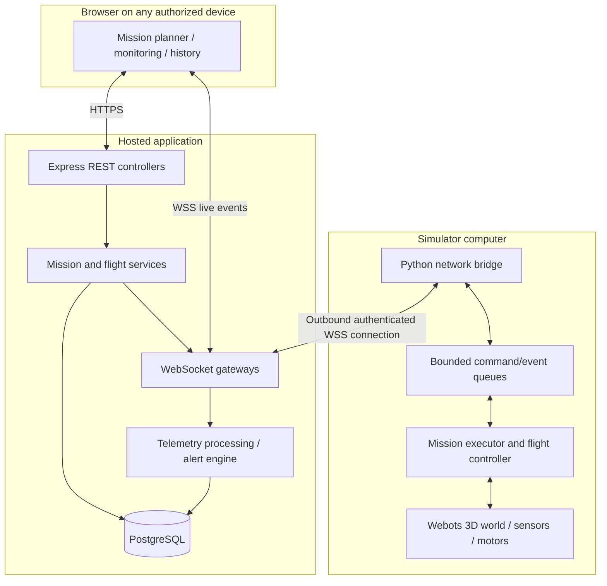

# Complete implementation and evaluation plan

Status: planned, not implemented. Read with PRD.md (acceptance requirements), ENGINEERING.md (technical design), and ../AGENTS.md (coding rules). No dates or person assignments are committed until the current deadline and team capacity are known.

## 1. Deliverable
A hosted React/JavaScript mission-control website connected through a Node.js/Express backend to a Webots drone running on a separate computer. Operator plans a route visually, requests execution, sees live simulated telemetry, pauses/resumes/lands, and reviews saved results.

Core demonstration: plan three waypoints -> start -> see drone move in Webots and on dashboard -> pause/hover -> resume -> inject low battery -> acknowledge alert -> land -> open report. Secondary demonstration: disconnect agent and show stale data, local failsafe and reconciliation.

One drone, one active flight, simple 3D world. Local Webots window is sufficient for MVP; separate browser 3D viewer is optional. No AI, GPS map, obstacle avoidance, manual internet joystick control or multi-drone support in the required build.

## 2. Stack
| Area | Baseline |
|---|---|
| Frontend | React, JavaScript/JSX, Vite, CSS modules/plain CSS, Recharts |
| Route planning | SVG top-down environment map; click/drag waypoints; editable altitude/order |
| Backend | Node.js, JavaScript ES modules, Express, ws, Zod |
| Persistence | PostgreSQL, pg parameterized SQL, node-pg-migrate |
| Simulation | Native Webots and Python drone controller/bridge |
| Contracts | Versioned JSON schemas/examples, JSDoc; Python boundary validation |
| Tests | Node test runner, Supertest; pytest for simulator; Vitest/RTL; Playwright |
| Development | npm lockfile, Python environment lock, Git, Docker Compose for backend/database |
| Deployment | Static assets + long-running Node process + PostgreSQL + HTTPS/WSS reverse proxy |

Exact compatible versions are pinned during setup. No TypeScript. Domain logic is object-oriented and framework-independent; functions remain appropriate for simple transformations.

## 3. End-to-end architecture

Command path: browser -> API validation -> domain/service transaction -> saved identified command -> simulator gateway -> bridge -> controller -> acknowledgement/result -> database/UI.

Telemetry path: Webots sensors -> local snapshot -> bridge -> schema/session/sequence validation -> database -> alert/live update -> browser. Motor stabilization remains local and never waits for cloud traffic.

## 4. Design before each feature
Do not spend weeks completing every diagram before proving the simulator. Start with minimum context diagram, coordinate contract, command schema and flight transitions; refine LLD alongside each milestone.

Final classes include Mission, Waypoint, MissionSnapshot, Drone, FlightSession, Command, TelemetrySample and Alert. Application services coordinate repositories and gateways through documented contracts. Controller interfaces do not leak Webots-specific axes or motor APIs into the backend.

SOLID/pattern evidence is defined in ENGINEERING.md. Use actual state encapsulation, interchangeable alert strategies, a Webots adapter, identified commands, event observers and justified handler creation. Every example must point to working code and a test, not just a diagram label.

## 5. Phased work breakdown

### Phase 0 — Scope and environment baseline
Tasks:
- Confirm team size, available hours, evaluation date and simulator computer OS/GPU.
- Check installed Node, Python, Webots and PostgreSQL/Docker capabilities.
- Record native Webots model/controller availability and third-party asset/controller attribution.
- Establish repository layout, environment examples, code style, test commands and issue IDs.
- Record architecture choices and assumptions in ADRs. Define world origin/axes/units once.

Deliverables: runnable setup checklist, environment manifest, initial architecture/flight-state sketch, issue backlog referencing FR/NFR IDs.
Exit: team can reproduce development setup; required assumptions are explicit. This phase does not require a styled frontend.

### Phase 1 — Local simulator feasibility (highest-priority risk)
Tasks:
- Open a small Webots world and select a suitable drone model/controller.
- Demonstrate stable takeoff, hover, movement to one local target, and controlled landing.
- Adapt model controller into a clear sensor -> state estimate -> target -> actuator loop.
- Implement local MissionExecutor with target tolerance, dwell and waypoint progression.
- Define pause as hover; resume continues the route; land cancels remaining navigation.
- Derive speed from suitable simulated sensor data or documented calculation. Label simplified battery model as synthetic.
- Verify mapping of dashboard x/y/altitude to actual model/world axes.

Deliverables: repeatable local test flight, model/controller version, observed accuracy and limitations, credited reused code.
Exit: three consecutive short flights take off, reach a target and land within documented tolerances. No teleporting via Supervisor fields as a substitute for flight-control proof.
If navigation fails, resolve controller feasibility before UI polish. Consider a different controller/simulator only through an explicit revised decision.

### Phase 2 — Minimal local browser round trip
Tasks:
- Create Express server and separate simulator/dashboard WebSocket handlers.
- Add versioned handshake, drone/session identity and command IDs.
- Bridge opens outbound connection, receives requests and hands them to a bounded local queue.
- Local controller returns acceptance/rejection and completion events.
- Send altitude/state telemetry at approximately 5 Hz in real-time simulation.
- Build a plain browser page with connection state, Take off, Land, altitude and command status.
- Add stub/fake adapter contract tests without claiming they prove Webots operation.

Deliverables: real browser -> backend -> Webots -> browser loop and initial command/telemetry contracts.
Exit: button causes actual simulated flight; pending/accepted/completed are distinguishable; duplicate action is handled; telemetry loss is visible.
Takeoff-only is a temporary spike command. Product start later wraps takeoff and mission execution.

### Phase 3 — Early hosted feasibility
Tasks:
- Deploy minimal frontend/server to persistent HTTPS/WSS infrastructure.
- Add initial operator protection and separate simulator credential, then complete auth hardening in Phase 4.
- Configure allowed origins, heartbeat and reconnect with bounded backoff.
- Connect laptop bridge outward; test dashboard from a phone or another computer.
- Verify hosting does not terminate sockets unexpectedly or require unsupported ephemeral execution.
- Record acknowledgement round-trip distributions, not assumed latency figures.

Deliverables: hosted proof, deployment ADR, observed network behaviour.
Exit: second-device browser reliably requests takeoff/landing and receives telemetry; no simulator secrets in browser code. Do not expose an unauthenticated command endpoint publicly.

### Phase 4 — Persistent domain and authentication foundation
Tasks:
- Implement domain objects and legal transitions; isolate services, repositories and transport adapters.
- Create migrations for users, sessions/auth storage, drones, missions/waypoints, flights, commands, simulator sessions, telemetry and alerts.
- Implement parameterized SQL, transaction-owned unit of work, indexes and database constraints.
- Seed operator accounts, hash passwords, use secure session cookies, enforce ownership, CSRF and WebSocket Origin validation.
- Implement optimistic mission revision checks and scoped simulator authentication.
- Atomic start creates immutable snapshot, flight and command; unique partial index prevents concurrent active flights.
- Persist idempotency keys with request hashes and document command delivery/recovery gaps.

Deliverables: schema/ER diagram, API skeleton, domain tests, PostgreSQL integration tests.
Exit: invalid transitions fail; simultaneous starts create at most one active flight; sessions/authorization work; rollback leaves no partial start records.

### Phase 5 — Visual mission planner
Tasks:
- Publish versioned world metadata: bounds, origin, landing-pad/building footprints, permitted altitude and route limits.
- Draw matching top-down layout with SVG; convert pointer position to local metres.
- Add/move/remove/reorder waypoints and edit altitude; show route, labels and bounds.
- Save/load missions; distinguish draft validity from executable validity.
- Validate complete route within supported world. If buildings are visual scenery only, do not imply obstacle safety; keep demo route in clear area.
- On start use immutable mission snapshot; edits affect future flights only.

Deliverables: usable mission editor, mission CRUD and validation acceptance evidence.
Exit: planned positions align with Webots positions; invalid/out-of-bounds data is rejected by backend and simulator; stale edits return revision conflict.

### Phase 6 — Mission execution and live dashboard
Tasks:
- Replace spike-only controls with Start Mission, Pause, Resume and Land.
- Show flight state separately from connection freshness and command status.
- Display local route/drone position, altitude, speed, attitude, synthetic battery and waypoint progress.
- Send bounded historical window for charts; coalesce live display updates for slow browsers.
- Rehydrate from backend snapshot on browser reload; never infer success solely from click.
- Record telemetry/events and preserve ordering/session checks.

Deliverables: core planned mission executes end-to-end; matching class/state/sequence diagrams.
Exit: three-waypoint mission, pause/hover/resume, early landing and normal completion work; browser refresh does not start or stop a flight.

### Phase 7 — Failures, alerts and recovery
Tasks:
- Implement scheduled freshness checking independent of telemetry arrival.
- Low-battery rule opens one incident; thresholds/reset behaviour are configurable and tested.
- Enforce command expiry, duplicate ID semantics, late acknowledgement reconciliation and session fencing.
- Local wall-clock watchdog requests landing after configured backend silence while simulation runs.
- Handle reconnect/backend restart/simulator restart without automatic stale command replay.
- Recording degradation and bounded-buffer gaps are explicit; unknown execution remains unknown until reconciled.
- Add labelled test controls for synthetic low battery and connection interruption.

Deliverables: failure matrix, repeatable injections, structured logs and recovery tests.
Exit: evaluator can see one failure, understand its state transitions and inspect its persisted evidence. A paused/stopped Webots engine is documented as unable to execute landing until running again.

### Phase 8 — History and post-flight report
Tasks:
- Flight list and paginated telemetry retrieval.
- Render saved route and altitude/battery charts.
- Compute duration using simulation time, maximum relative altitude, estimated sampled route distance and battery change.
- Show completion/interruption reason, alerts, command timeline and data gaps.
- Retain snapshot even if source mission changes or is archived.

Deliverables: report and analysis tests against known fixture data.
Exit: summary agrees with fixture calculations and recorded session; missing data is disclosed rather than silently interpolated as certain.

### Phase 9 — Evaluation release
Tasks:
- Run domain, PostgreSQL, protocol, UI and actual Webots end-to-end checks.
- Complete class diagram with real methods/visibility/multiplicities, ER diagram and core sequence/activity diagrams.
- Map each rubric item to artifact, source class and demonstration/test evidence.
- Verify hosted setup, credential handling, startup/reset, dependency locks and DB restore procedure.
- Record measured timing under declared load; capture demo video as backup.
- Assign individual contribution walkthroughs and cross-review design consistency.

Deliverables: working release, setup/runbook, rubric matrix, test/measurement report, contribution record and presentation.
Exit: another team member can start system using instructions and demonstrate it without hidden repairs.

## 6. Critical path and parallel work
Critical path: local flight -> actual command/telemetry round trip -> hosted connectivity -> durable mission execution -> failure handling -> assessment evidence.

Once Phase 1 validates coordinates/control, team members may work concurrently on simulator/bridge, backend/persistence and frontend/planning. Agree contracts first. Each owner delivers requirement, design, code, tests and evidence rather than only screens. Everyone reviews another area. Do not allocate names or assume team count yet.

Suggested effort allocation (not calendar estimates): feasibility/connection 25%, domain/database/contracts 20%, planner/live UI 20%, reliability/reports 20%, integrated verification/presentation 15%. Adjust after first measured milestones; reserve time for integration rather than committing dates without capacity.

## 7. Verification and latency plan
| Scenario | Expected evidence |
|---|---|
| Invalid target / unsupported world | Consistent validation rejection at boundaries |
| Two simultaneous starts | One active flight; other request receives conflict |
| Duplicate request and different payload with same key | Same request returns same result; changed payload conflicts |
| Duplicate/out-of-order telemetry | No duplicate history; latest display never moves backwards due to old messages |
| Lost acknowledgement | Unknown outcome reconciles without duplicate flight action |
| Network disconnect | Dashboard becomes stale, local watchdog acts, reconnect reports actual outcome |
| Browser refresh | Existing flight reconstructed; no new start |
| Database outage | Recording marked degraded; bounded buffering/gaps exposed |
| Simulator restart | New epoch and explicit reconciliation, no silent continuation |
| Full mission | Real Webots movement, event record, saved report and consistent snapshot |

Initial acceptance targets remain 95% command acknowledgements within 2 seconds under normal demo conditions and about 5 Hz telemetry. The earlier 100–500 ms discussion was only a rough expectation, not a guarantee or measurement.

Measure browser click-to-ack using one browser monotonic clock; backend dispatch-to-ack using one backend monotonic clock; simulator receipt-to-action using local monotonic time. Report median/p95/max, sample count and conditions. Cross-machine timestamp subtraction is invalid without clock synchronization/error bounds. For display freshness use an instrumented echo/round-trip proxy or documented synchronized-clock method; do not claim a backend-to-render one-way result from unrelated clocks. Controller action onset and completion are distinct from network acknowledgement.

## 8. Rubric completion checklist
- [ ] Functional/non-functional requirements, actors, use cases and acceptance criteria.
- [ ] Actual class diagram with attributes, methods, visibility and justified multiplicities/relationships.
- [ ] Encapsulation, abstraction, useful inheritance/polymorphism and explicit interface contracts.
- [ ] All five SOLID principles explained with implemented code and limitations.
- [ ] Justified creational, structural and behavioural patterns, not pattern-count scaffolding.
- [ ] Actual core sequence and activity/state diagrams.
- [ ] REST OpenAPI, versioned WS schemas, clean controller/service/repository boundaries.
- [ ] ER diagram, migrations, keys, relationships, indexes and constraints matching domain design.
- [ ] Invalid input, failures, concurrency, reconnect and command uncertainty evidence.
- [ ] End-to-end code, reproducible deployment and individual contribution explanations.

## 9. Change control and first action
No new feature enters MVP without identifying its requirement, effort/risk and effect on remaining gates. Update PRD/design/ADRs when scope changes. Optional 3D web streaming begins only after the evaluation checklist passes for required functionality.

Next executable task: inspect simulator-machine prerequisites and prove a local Webots drone can take off, hover, navigate to one target and land. Application development follows that feasibility gate; this plan does not imply code already exists.
