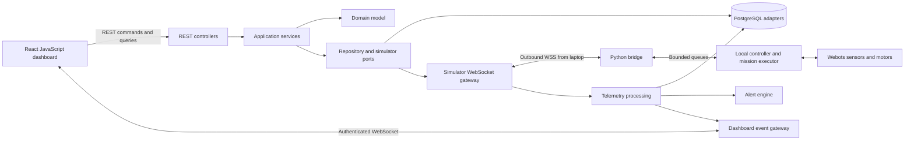
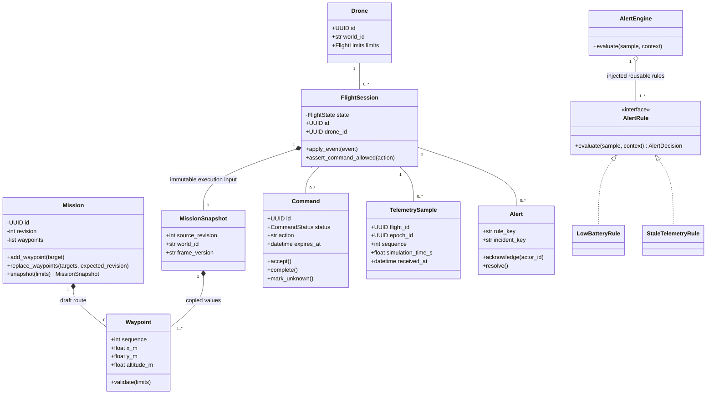
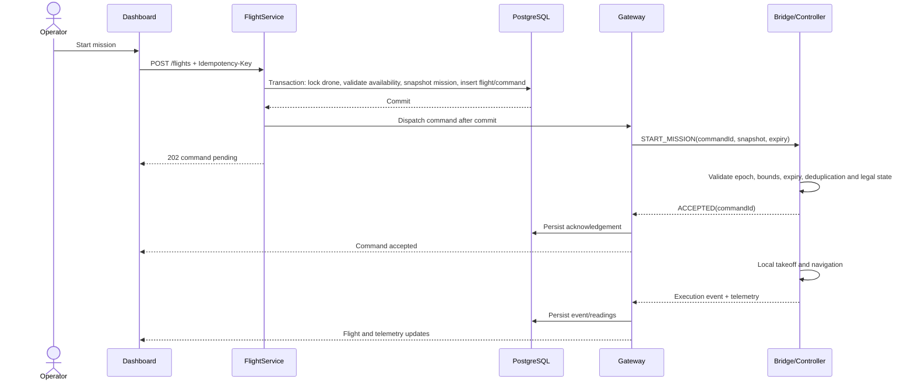

# Systems engineering and software design baseline

Status: proposed design; diagrams/signatures must be updated as code is implemented. Requirements and acceptance targets live in PRD.md. Frontend and Node.js/Express backend use plain JavaScript, per user preference. Python is limited to Webots controller/bridge.

## 1. Engineering workflow
For each change: identify requirement -> define invariant/contract -> update relevant design -> implement smallest vertical slice -> verify acceptance and failure behaviour -> save evidence. Git issues should reference FR/NFR IDs; pull requests or change notes state problem, design choice, verification and limitations.

Maintain docs/decisions/ADR-NNN-title.md for important choices: context, options, decision, tradeoffs, consequences, verification status. Initial decisions to record: Webots feasibility, Node.js/Express modular backend, local coordinate frame, single worker, command reconciliation, authentication/deployment.

Systems engineering covers both software and operating environment: simulator/controller compatibility, timing assumptions, network loss, compute requirements, deployment, recovery, reproducibility and integrated verification. Each milestone has exit evidence; do not label a proposed integration as proven.

## 2. Architecture and dependencies


Backend is a modular monolith, initially one long-running process/worker. Static frontend may be on a separate host. Webots runs natively on the simulation computer. Controller APIs are accessed only from the control thread; transport tasks exchange data through bounded queues. Control loop must not await cloud requests.

REST controllers validate DTOs and map domain errors; application services coordinate use cases/transactions; domain methods own invariants; repositories perform persistence; adapters translate external protocols. Dependency direction points toward domain/interfaces, not frameworks.

No Redis, Kafka, Kubernetes or microservices in MVP. In-memory event distribution has no durable delivery guarantee. Database command records plus reconciliation handle command uncertainty; telemetry gaps are explicitly reported. Scaling to several backend workers would require shared connection routing/event distribution and is outside current scope.

## 3. Proposed repository layout
```text
frontend/src/
  api/ components/ features/missions/ features/flights/ contracts/
backend/src/
  domain/                 # entities, value objects, state transitions, rules
  application/            # use cases and ports
  interfaces/http/        # routes, DTOs, error mapping
  interfaces/websocket/   # authenticated transport handlers
  infrastructure/         # pg repositories, gateway, clock
backend/migrations/
backend/tests/{unit,integration}/
simulator/
  worlds/ controllers/ bridge/ tests/
contracts/                # protocol schemas and representative messages
docs/{decisions,evidence}/
```

Use plain JavaScript/JSX, ESLint, JSDoc for important frontend and backend interfaces, and runtime schemas for network messages. Validate independently on backend and simulator; frontend checks improve UX but are not an enforcement boundary. No frontend secrets or simulated motor-control logic.

## 4. Domain classes and relationships
Representative design, not a generated class inventory. Final assessment diagram must include actual attributes, operations, visibility and multiplicities for implemented classes.



Waypoints in snapshot and draft are different immutable value instances. Telemetry and commands are associations rather than lifecycle deletion composition: retention/audit policy is independent. The rule collection demonstrates aggregation because rules are supplied externally and do not derive their lifecycle from the engine. Do not use UML relationship symbols solely for decoration.

OOP: encapsulate flight state behind domain transitions; use validated immutable value objects where suitable; document abstract ports with JSDoc and enforce contracts through tests. Rule subclasses demonstrate actual substitutability. Avoid Drone -> FlyingDrone -> PausedDrone inheritance; flight state changes are behaviour/state, not identity types.

## 5. SOLID and patterns
| Principle | Concrete responsibility / evidence |
|---|---|
| SRP | Mission validation, controller stabilization, network transport and report aggregation are separate |
| OCP | Add alert implementations through the rule registry without changing AlertEngine evaluation logic |
| LSP | Every AlertRule obeys same input/output/error contract, does not mutate input, and passes shared contract tests |
| ISP | Separate command delivery, connection query and telemetry ingestion ports; consumers depend only on necessary operations |
| DIP | Application services receive repository, clock and simulator interfaces; infrastructure implements them |

| Pattern category | Pattern | Why and implementation limit |
|---|---|---|
| Creational | Factory | CommandHandlerFactory resolves an action to an injected handler; reject unsupported actions consistently |
| Structural | Adapter | WebotsControllerAdapter translates normalized targets/sensors to model-specific APIs and axes |
| Behavioural | Command | Identified requests can be validated, tracked and reconciled; serialized command records do not require serializing Python objects |
| Behavioural | Strategy | Low battery/freshness rules have interchangeable evaluation contracts |
| Behavioural | Observer | Telemetry publisher notifies alert and browser consumers; observer alone provides no reliable delivery guarantee |

Prefer explicit transition tables to many state classes initially. Introduce State pattern only if state-dependent behaviour warrants it. No application-wide Singleton requirement; lifecycle-managed injected services are sufficient.

## 6. Ports and method contracts
Illustrative JavaScript contracts; implementation must define JSDoc DTOs, runtime schemas and domain error classes. Ports describe behaviour, not TypeScript interfaces. Repositories are asynchronous and participate in a unit of work.

```javascript
/** @interface */
class MissionRepository {
  async get(missionId) { throw new Error('Not implemented'); }
  async save(mission, expectedRevision) { throw new Error('Not implemented'); }
}

/** @interface */
class CommandTransport {
  async send(envelope) { throw new Error('Not implemented'); }
}

class FlightService {
  constructor({ unitOfWork, commandTransport, connectionQuery, clock }) {
    Object.assign(this, { unitOfWork, commandTransport, connectionQuery, clock });
  }
  async start({ operatorId, missionId, expectedRevision, requestKey }) {
    // Coordinate domain rules and one database transaction, then dispatch.
  }
  async requestAction({ operatorId, flightId, action, requestKey }) {
    // Validate lifecycle and persist an identified request.
  }
}

/** @interface */
class AlertRule {
  evaluate(sample, context) { throw new Error('Not implemented'); }
}
```

JSDoc `@interface` documents a contract; it does not enforce it at runtime. Shared contract tests verify substitutability. Prefer private fields for encapsulated domain state. Use Zod at JavaScript network boundaries and equivalent validation in Python; never trust browser validation alone.

StaleTelemetryRule must run from a scheduled freshness check, not only on telemetry arrival; otherwise missing messages cannot trigger it. Inject clock so timeout logic is testable. Repository methods participate in a service-owned unit of work; individual methods must not silently commit half a use case.

## 7. Command lifecycle and sequence
Command status: PENDING -> ACCEPTED -> COMPLETED or FAILED; PENDING may be REJECTED. Timeout becomes UNKNOWN. UNKNOWN can later reconcile to ACCEPTED/COMPLETED/FAILED. Events have monotonically increasing per-session ordering; ignore backwards transitions. A start acknowledgement differs from actual takeoff and mission completion.



Commit/send gap is real. On crash after commit, command remains pending; startup/reconnect reconciles pending commands and expiry. Never blindly redispatch an uncertain command. This is a modest recovery design, not an exactly-once transaction across network and database.

Additional diagrams required before related features are done: mission editing activity; telemetry validation/storage/alerts sequence; pause/resume state transition; disconnect/watchdog/reconciliation sequence.

## 8. REST and event contracts
| Method / path | Result |
|---|---|
| POST /auth/login; POST /auth/logout | Authenticated operator session lifecycle |
| GET/POST /missions | List/create |
| GET/PATCH /missions/{id} | Read/edit with expected revision |
| GET /drones | Availability, frame, capabilities and freshness |
| POST /flights | Start from mission ID + expected revision + request idempotency key |
| POST /flights/{id}/commands | PAUSE, RESUME, LAND |
| GET /flights; GET /flights/{id} | History / snapshot and current state |
| GET /flights/{id}/telemetry?after=...&limit=... | Bounded paginated history |
| GET /flights/{id}/report | Summary plus completeness metadata |
| POST /alerts/{id}/acknowledgement | Persist operator acknowledgement |
| WS /ws/dashboard | Authenticated subscriptions and state snapshots |
| WS /ws/simulator | Authenticated simulator handshake, commands, telemetry/events, reconciliation |

Errors use stable codes, e.g. `{ "error": { "code": "INVALID_FLIGHT_STATE", "message": "Cannot resume while landing", "requestId": "...", "details": {} } }`. Use 401 unauthorized, 403 forbidden, 404 missing, 409 revision/state/idempotency conflict, 422 invalid input, 503 simulator unavailable. Unexpected failures return redacted 500 errors and correlated logs.

Common WS envelope: protocolVersion, messageId, type, droneId, simulatorSessionId, flightId where applicable, payload. Commands additionally carry commandId and expiry. Telemetry carries epochId, sequence, simulationTimeSeconds, position, attitude, speed, batteryPercent and source labels. Backend adds receivedAt. Distinguish heartbeat from sensor telemetry.

Coordinate contract: WORLD_LOCAL_V1; x=east-like local axis, y=north-like local axis, altitude=up relative to a fixed landing-pad origin; metres, seconds, m/s, radians, percent. These are local conventions, not GPS. Adapter explicitly maps Webots/model axes and tests basis vectors. Store world/frame ID and origin configuration in flight snapshot. Reject mission for mismatched world.

Specify maximum message size, route length, timestamp ranges and rate limits in configuration; reject NaN/infinity and unauthorized drone IDs. Unknown protocol versions fail handshake. Keep shared JSON schema/examples in contracts/ and run consumer/provider contract tests.

## 9. Database and transaction design
| Table | Main columns / constraints |
|---|---|
| users | id PK, login UNIQUE, password_hash, enabled |
| drones | id PK, world_id, limits/config, credential_hash |
| missions | id PK, owner_id FK, name, revision, world_id, timestamps |
| waypoints | id PK, mission_id FK, sequence, x_m, y_m, altitude_m; UNIQUE(mission_id,sequence) |
| flight_sessions | id PK, drone_id FK, mission_id FK, source_revision, snapshot JSONB, reported_state, outcome, timestamps |
| commands | id PK, flight_id FK, requester_id FK, request_key, request_hash, action, payload, status, expiry, timestamps |
| simulator_sessions | id PK, drone_id FK, epoch_id, connection generation, last_heartbeat_at, closed_at |
| telemetry_samples | id PK, flight_id FK, epoch_id, sequence, simulation_time_s, received_at, measurements; UNIQUE(flight_id,epoch_id,sequence) |
| alerts | id PK, flight_id FK nullable for connection alert, drone_id FK, rule_key, incident_key, status, occurrence/ack timestamps |

Indexes: telemetry(flight_id,simulation_time_s,id); flight_sessions(drone_id,created_at); commands(flight_id,created_at); alerts(flight_id,status). Unique partial index for one active flight per drone; explicit active outcome/status predicate must match domain definition. Unique request key per operator prevents duplicate start requests; compare canonical request hash and return 409 if same key has different content. Unique open alert incident per drone/flight/rule prevents floods.

Start transaction locks drone row, verifies availability, snapshots mission at expected revision, inserts flight and command, commits before network dispatch. Database constraint is final concurrency guard. Mission edits use optimistic revision checks. Retain flight snapshot/history when source mission is archived; do not cascade-delete audit data. Parameterized SQL and explicit row mappers belong in infrastructure; database rows are not the domain definition.

At 5 Hz, one ten-minute flight produces about 3,000 samples. PostgreSQL is sufficient for the scoped demo; no time-series database is justified yet. Bound queries and avoid unlimited history payloads. Report distance sums ordered valid segments and flags gaps; label it estimated path distance, not exact physical travel. Use simulation timestamps for flight duration and wall time for network freshness.

## 10. Reliability, security and operations
- Durable command ID/status on backend; local controller tracks processed IDs for session lifetime. On controller restart do not claim dedup survives: establish new epoch, reconcile and require explicit recovery.
- Only one active session generation per drone. Reject messages from fenced older connections. Reconnect cannot silently create a second executor.
- Telemetry deduplicates by epoch and sequence; older samples may be stored but never overwrite newer live display state. Reject data for wrong flight/session.
- Bounded ingress queues: command results prioritized over display telemetry. Persist accepted samples before dashboard publication; storage failure marks recording degraded and emits an error instead of implying success.
- Slow browser consumers may receive coalesced latest-state updates; historical recording and display sampling are separate concerns.
- Heartbeat/watchdog uses monotonic wall time locally. Simulation pause/speed change must not be confused with wall-clock latency.
- Auth proposal: seeded operator accounts with strong password hashing; HttpOnly secure session cookie through same-origin /api and /ws reverse proxy. Validate WebSocket Origin and use CSRF protection for state-changing requests. Simulator uses a separate scoped credential supplied through local environment, never a query string/browser bundle.
- Backend checks ownership/authorization for mission and flight access. CORS is not authentication. No arbitrary code execution from commands.
- Health/readiness endpoints distinguish process liveness from database readiness; structured logs and command RTT/gap/error counters support diagnosis.
- Hosting must support persistent WSS and explicit idle/heartbeat settings. One backend worker; deploy migration before serving compatible code. Native Webots host remains separate.
- Evidence includes pinned environment, startup order, reset/demo procedure, DB backup/restore steps, and known limitations. Avoid paid-provider selection before needs are confirmed.

## 11. Verification matrix
| Test level | Required meaningful coverage |
|---|---|
| Unit | Mission bounds/finite values; transition table; command outcomes; battery incident lifecycle; freshness timer using fake clock |
| Contract | Versioned JSON messages; all AlertRule implementations; fake and Webots adapter contract where feasible |
| PostgreSQL integration | Concurrent start; revision conflicts; unique sample/request IDs; transaction rollback; snapshot immutability |
| Transport integration | Auth/unauthorized drone, malformed messages, expiry, duplicate command, reconnect/fencing, late acknowledgement |
| UI | Pending command, rejected action, stale values, reconnect snapshot, route edit validation |
| Webots end-to-end | Takeoff/target/land, multi-waypoint route, pause hover, connection-loss local landing in running simulation |
| Hosted acceptance | Browser on second device -> actual simulator movement -> telemetry -> recorded report |

Do not count mocked movement as proof of Webots integration. Record observed tolerances, network conditions, versions and failing limitations. Class/sequence diagrams are reviewed against code, not only rendered for presentation.

## 12. Rubric traceability and team practice
| Evaluation item | Required artifact / proof |
|---|---|
| 1 Requirements | PRD FR/NFR IDs, actor/use-case descriptions, acceptance evidence |
| 2 Class diagram | Final entities/services/interfaces, attributes/methods, multiplicities and justified relationship types |
| 3 OOP | Domain invariants, immutable values, JSDoc port contracts, useful polymorphism with code references |
| 4 SOLID | Mapping in section 5 updated with actual class/file links and tradeoffs |
| 5 Patterns | Creational/structural/behavioural examples in section 5 with actual code and justification |
| 6 Sequence/activity | Start, telemetry, pause/land, disconnect and mission-edit flows reflecting real calls |
| 7 API/interfaces | OpenAPI REST spec, versioned WS schemas, error contracts, layer boundaries |
| 8 Database | ER diagram, migrations, FK/index/constraint inventory, domain mapping explanation |
| 9 Failures/concurrency | Automated edge-case results and a repeatable failure demonstration |
| 10 Working code | Reproducible end-to-end demo, modular source, tests and design consistency |

Each member owns a bounded feature from requirement to code/test/design evidence and reviews another feature. Everyone should explain the whole command/telemetry path, one database invariant, one pattern, one failure scenario, and their own contribution. Assign names only after team composition is known.

## 13. Initial risk register
| Risk | Mitigation / gate |
|---|---|
| Chosen drone controller cannot navigate reliably | Prove M1 first; adapt suitable controller or revise simulator choice through ADR |
| Spending most time on physics/graphics | Simple world, reuse credited assets/controllers, no obstacle avoidance |
| Hosted connection unreliable or sleeping | M3 from second device, long-running process, heartbeat/reconnect evidence |
| Controller blocks on network | Queue boundary; local stabilization and watchdog |
| Diagram/code divergence | Definition of done includes design update and review |
| Restart creates ambiguous commands | Persist IDs, fence sessions, expire/reconcile, explicit unknown outcome |

## 14. Immediate next work
Confirm simulator computer environment; install/pin Webots; select and credit model/controller; prove local takeoff/hover/target/landing. Then implement minimal local browser-backend-bridge round trip. This documentation does not imply that any of those capabilities has already been built.
