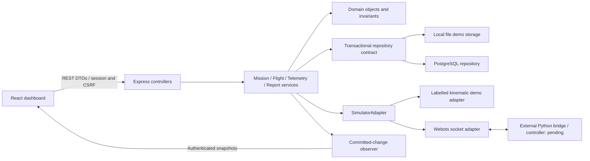

# Engineering rules and architecture

Current stack: React/JavaScript + Node.js/Express + PostgreSQL/Supabase; Python only for the Webots bridge/controller. Dashboard/backend is built first with a labelled demo adapter, per ADR-002. Pairing replaces login/signup, per ADR-003. **Actual class/ER/sequence/activity diagrams and rubric mapping are in IMPLEMENTATION.md.**

## Architecture

One modular backend process. No microservices/broker/Kubernetes. Ports are documented JavaScript contracts; injection and contract tests supply substitutability, not TypeScript declarations.

## Responsibilities and ownership
- React: route editing/display and user requests. Never calculates live drone motion or authoritative state.
- HTTP: validate DTOs, session/origin/CSRF, call services, map errors.
- Application services: use cases, transactions, request idempotency, event publication.
- Mission: revision/edit rules, validated ordered values, immutable snapshots.
- FlightSession: legal lifecycle transitions and command permissions.
- FlightCommand: acceptance/completion/cancellation/unknown outcome.
- Repository: atomic commit/rollback and storage translation. Domain imports no pg/Express/Webots.
- Simulator: actual execution/physical state. Demo is a replaceable test implementation; Webots controller remains a separate gate.
- Backend records reported execution state; connection freshness is orthogonal. It must not infer successful landing from silence.

## Core invariants
1. One active flight per drone, finally enforced by SQL partial unique index.
2. Draft may be empty; executable mission needs at least one valid waypoint.
3. X/Y ±50 m and waypoint altitude 2–15 m in WORLD_LOCAL_V1. No GPS implication.
4. Flight stores a copied mission snapshot. Later edits/archival preserve historical meaning.
5. Revision mismatch rejects edits/start instead of silently overwriting.
6. Same owner/request-key + same content returns existing command. Changed content with same key conflicts.
7. Delivery timeout means unknown outcome. Do not blindly resend movement commands.
8. Telemetry duplicate flight/epoch/sequence does not duplicate history; old sequence cannot overwrite live values.
9. A different epoch requires reconciliation, not automatic continuation.
10. Repeated threshold readings do not open duplicate active incidents.

## OOP / SOLID / patterns
Use private state, immutable copies/value objects and genuine subclass contracts. Mission/FlightSession/FlightCommand encapsulate rules; AlertRule and SimulatorAdapter define abstractions. LowBatteryRule/StaleTelemetryRule and DemoAdapter/WebotsAdapter demonstrate inheritance/polymorphism.

SRP is demonstrated by domain, orchestration, report, auth, storage and transport boundaries. OCP and LSP are demonstrated by alert strategy extension and contract tests. ISP keeps service collaborators small rather than depending on HTTP/UI APIs. DIP is realized by createRuntime injecting repositories/gateways/publishers.

Patterns: SimulatorFactory (creational); WebotsAdapter/storage adapters (structural); FlightCommand, alert Strategy and committed-change Observer (behavioural). Add no pattern solely to fill a count; no Singleton is required. IMPLEMENTATION.md maps each to actual code.

## Pairing / security
No login/signup UI. Bridge has a long configured bootstrap credential and obtains a four-character alphanumeric pairing code. Browser code is single-use, expires in 2 minutes, origin/rate limited, and has a five-guess budget. It creates a random HttpOnly session plus CSRF token. The short code is never the persistent control credential.

Pairing/session maps are ephemeral, scoped to a single installation principal. Re-pair after restart. Local demo shortcut is disabled in production. Production requires PostgreSQL, Webots mode, HTTPS origin and long bridge credential. Never put database passwords or bootstrap secrets in VITE_ variables. Do not log credentials or persist them in Git.

Supabase is database hosting; application rules stay in Express. SQL RLS has no browser-client policies. Use correct verified TLS/direct or session-pooler configuration. Publishable keys cannot execute SQL migrations. Hosted session-pooler connection, verified TLS, migration and write/read/rollback are now verified; real load/concurrency remain separate acceptance checks.

## Database and transactions
Migration source: backend/migrations/001_initial.sql. Relational operators, drones, missions/waypoints, flight_sessions, commands, telemetry_samples and alerts; indexed constraints and JSONB aggregate records/snapshots. Waypoint rows update transactionally with mission data.

PostgresRepository owns transaction connection, uses advisory lock to serialize the one-drone write workload, and commits before transport dispatch. FileRepository is atomic replacement with a single-process promise queue, explicitly a demo limitation. SQL reads use repeatable snapshots. All user data is parameterized; table/column lists are fixed code.

The current state-oriented repository loads full history and is designed for small demonstrations, not measured high-rate scale. Use paginated/incremental repositories before expanding fleet size or retention. Real multi-connection concurrency tests are a separate deployment gate; embedded PostgreSQL proves schema/query semantics only.

## Timing, failures and recovery
Target telemetry is 5 Hz in real-time simulation; stabilization stays local at the chosen Webots timestep. Wall time measures freshness; simulation time measures flight duration.

Stale check runs on a timer, not just telemetry arrival. Agent heartbeat timeout is 5 seconds; sensor stale threshold is 3 seconds. HTTP health is liveness only. Malformed bodies, bounds errors, unknown state/epoch, authentication/origin/CSRF errors have explicit outcomes. Invalid agent protocol closes its socket. Ingress/backpressure and slow browser clients are bounded.

Persisted unconfirmed commands become UNKNOWN after backend restart. Demo does not resume an orphaned flight. Operator may record interrupted/unknown outcome while disconnected and reconnect test link. Demo disconnect suspends test execution; it does not prove a Webots watchdog. Actual local controlled landing on connection loss and controller restart reconciliation remain requirements for Webots integration.

Commit/send gap is not a distributed transaction. No exactly-once claim. Observer notifications are not durable event delivery. Reports flag sequence gaps and label sampled path distance/battery estimates appropriately.

## Verification and evidence
Relevant tests: domain invariants, transitions, alert strategies, code pairing/session/CSRF, revision/ownership/idempotency, offline start, demo pause/resume/early land, file rollback/reopen, embedded PostgreSQL schema/repository, and external-agent socket exchange.

For each feature: FR/NFR -> contract/design -> implementation -> meaningful tests -> observed acceptance -> evidence. Keep diagrams/API/schema synchronized. PR descriptions state behaviour and verification, not conversational history.

Webots/hosted checks must use actual systems and cannot be replaced by fake telemetry. Measure command RTT on one monotonic clock; do not subtract unsynchronized timestamps across devices. Record median/p95, samples, versions and conditions. Every member should explain the command path, one invariant/pattern/failure, and their own contribution.
