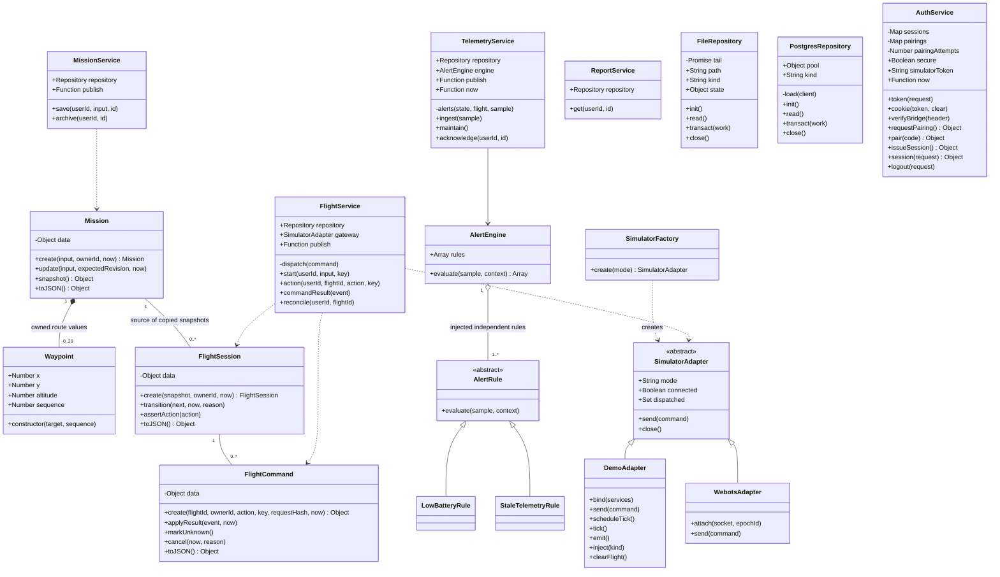
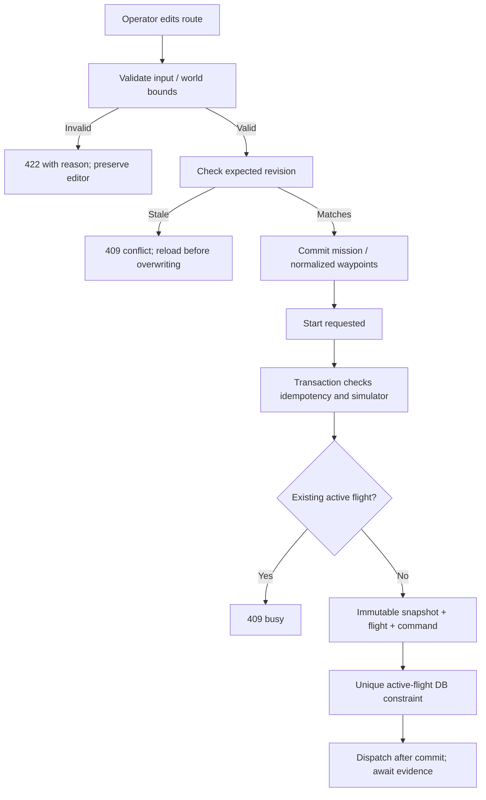
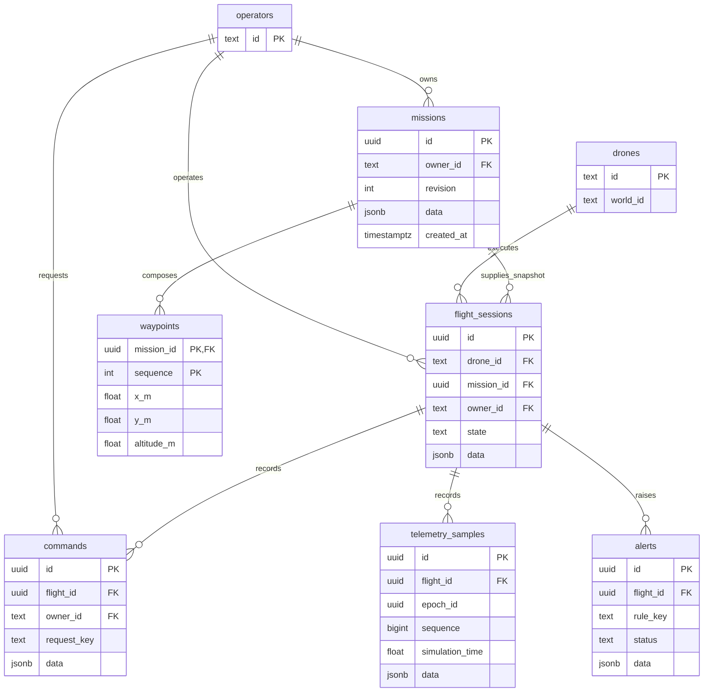

# Implemented design and evaluation guide

This is the as-built local dashboard/backend design. PRD.md and ENGINEERING.md include broader planned Webots requirements; this document distinguishes working application behaviour from pending integration. The delivery order is overridden by ADR-002, identity design by ADR-003.

## 1. Requirements and actors
Actor: a paired operator controlling the installation's one drone. Agent: demo adapter now, external Webots agent later. No login/signup or multi-tenant roles. Four-character bridge pairing replaces password-based entry.

| Use case | Requirement | Implemented behaviour |
|---|---|---|
| Pair control session | revised FR-01 | Single-use 2-minute alphanumeric code; long HttpOnly session; CSRF/origin checks |
| Plan mission | FR-02/03 | Click/drag local XY targets, edit altitude/order, save draft, revise, archive |
| Execute/control | FR-05/07/08/09 | Command records, acknowledged start/pause/resume/land through adapter; early land supersedes start |
| Monitor | FR-10/11 | Backend-generated demo telemetry, live snapshots, stale labels and scheduled freshness checks |
| Alert | FR-12 | Low battery/stale strategies, one incident per rule/flight, acknowledge/resolve |
| Review | FR-13/14 | Persisted history/snapshot, route/charts, command timeline, summary and JSON export |
| Integrate external agent | partial FR-04/06/15 | Authenticated socket transport/protocol test; actual Webots execution/reconciliation pending |

NFR targets in PRD remain measurement targets, not achieved latency claims. Embedded PostgreSQL verifies actual SQL/schema semantics; hosted Supabase and multi-client network concurrency need deployment evidence.

## 2. Actual class design


Snapshot, telemetry and alert records are validated plain value records, not separate claimed classes. Mission owns ordered waypoint values; flight owns a copied snapshot. Aggregation denotes injected alert strategies that can exist independently of the engine. Class object graph relationships are different from database cascade policy.

### Domain record attributes

| Class / record | Encapsulated or persisted attributes |
|---|---|
| Mission.#data | id, ownerId, revision, name, description, waypoints, worldId, frame, archived, createdAt, updatedAt |
| FlightSession.#data | id, droneId, ownerId, missionId, immutable snapshot, state, adapter, startedAt, endedAt, reason, latest telemetry |
| FlightCommand.#data | id, flightId, ownerId, action, requestKey, requestHash, status, createdAt, expiresAt, acceptedAt, completedAt, error |
| Telemetry value record | id, flightId, epochId, sequence, simulationTime, receivedAt, x/y/altitude, speed, battery/batterySource, roll/pitch/yaw, waypoint, state, optional reason |
| Alert value record | id, flightId, ruleKey, key, severity, title, message, status, createdAt, acknowledgedAt, optional resolvedAt |
| DemoAdapter runtime | epochId, queue, services, timer, flight, sample, pendingCommand; inherited mode/connected/lastSeen/dispatched |
| WebotsAdapter runtime | socket, epochId; inherited mode/connected/lastSeen/dispatched |

Async repository/service/transport methods return promises. Private helpers are implementation operations; record fields are not falsely presented as separate JavaScript classes.

## 3. OOP, SOLID and patterns in actual code
| Concept | Code evidence / reason |
|---|---|
| Encapsulation | Mission, FlightSession and FlightCommand keep private #data; state changes go through operations and exports are copies |
| Abstraction | SimulatorAdapter and documented repository port in application/ports.js isolate external concerns |
| Inheritance / polymorphism | AlertRule subclasses; DemoAdapter and WebotsAdapter implement the simulator contract |
| SRP | Domain invariants; MissionService use cases; ReportService calculations; AuthService identity; infrastructure persistence/transport |
| OCP | AlertEngine accepts strategies without changing its evaluation algorithm |
| LSP | Shared alert-rule contract tests; both repository implementations commit/rollback the same state contract. Physics/recovery capabilities are not claimed equivalent |
| ISP | Services consume only injected repository/gateway/publish operations, not HTTP/React APIs. Gateway surface remains small for this scope |
| DIP | Services accept collaborators in constructors; createRuntime wires infrastructure; domain imports no framework/database |
| Factory (creational) | SimulatorFactory selects exactly configured adapter; Webots mode never falls back to demo |
| Adapter (structural) | WebotsAdapter maps socket transport to send()/connection interface; File/Postgres repositories adapt storage to common unit-of-work contract |
| Command (behavioural) | FlightCommand is a first-class identified request with expiry/lifecycle/idempotency; transport/executor consumes serialized request |
| Strategy (behavioural) | LowBatteryRule and StaleTelemetryRule |
| Observer (behavioural) | EventEmitter distributes committed change notifications to authenticated browser subscriptions |

No Singleton or gratuitous inheritance. Database rows include domain snapshots for reproducible history. JavaScript JSDoc is documentation, not runtime interface enforcement; boundary schemas and tests enforce observable contracts.

## 4. Sequence: start and execute
```mermaid
sequenceDiagram
  actor Operator
  participant UI as React dashboard
  participant HTTP as Express controller
  participant Flight as FlightService
  participant Repo as Repository
  participant Adapter as SimulatorAdapter
  participant Telemetry as TelemetryService
  Operator->>UI: Start saved mission
  UI->>HTTP: POST /api/flights + CSRF + request key
  HTTP->>HTTP: Session and Zod validation
  HTTP->>Flight: start(principal,input,key)
  Flight->>Repo: Atomic idempotency/availability check + snapshot + command
  Repo-->>Flight: Committed request
  Flight->>Adapter: send(command)
  HTTP-->>UI: 202 pending request
  Adapter->>Flight: commandResult(ACCEPTED)
  Adapter->>Telemetry: ingest(TAKING_OFF)
  Telemetry->>Repo: Validate transition; persist readings/alerts
  Telemetry-->>UI: Committed snapshot via change observer / WS
  Adapter->>Telemetry: ingest(EXECUTING)
  Adapter->>Flight: commandResult(COMPLETED)
  Note over Adapter: Demo executes locally; real Webots controller remains pending
```

## 5. Activity: mission validation / concurrency


## 6. Implemented database schema


Source of truth is backend/migrations/001_initial.sql. Unique active-flight partial index prevents two ongoing flights per drone. Command owner/request-key uniqueness, telemetry flight/epoch/sequence uniqueness, waypoint composite PK, foreign keys and active-alert partial index enforce integrity. Waypoint rows update with mission revision in the same transaction. RLS prevents client Data API access without policies; backend performs operator checks as well.

PostgresRepository serializes writes with a transaction advisory lock for this one-drone scope, diffs aggregates before issuing parameterized upserts and reads consistent snapshots. Payload JSONB is deliberate to preserve complete immutable execution inputs; indexed relational fields support integrity. Current repository loads full state, so long-term/high-rate scaling requires paginated/incremental repositories. No scalability benchmark is claimed. FileRepository is atomic single-process demo storage only.

## 7. API/error contracts
See contracts/openapi.json for implemented REST operations and contracts/protocol.md for WebSocket/pairing details. Express controllers parse Zod schemas, call application services, map stable errors and return redacted unexpected errors with request IDs. No business rule is implemented only in React.

Important failures: 401 invalid/unpaired session; 403 origin/CSRF/disabled demo; 409 busy/revision/state/idempotency conflict; 422 invalid route; 503 agent offline. Timed-out requests become UNKNOWN, not rejected. Restart does not silently resume execution. Offline operator closure records INTERRUPTED without claiming landing.

## 8. Verification and remaining gates
Automated tests cover domain/state rules, code pairing and CSRF, mission revision/ownership, idempotent start, local concurrent starts, duplicate/out-of-order telemetry, alerts, demo command execution and early landing, rollback/reopen, actual SQL/schema semantics using embedded PostgreSQL, and external-agent WebSocket exchange using a test client.

Supabase session-pooler connection/migration and live write/read/rollback verification now pass (evidence/supabase-connection.md). Pending: real multi-connection PostgreSQL concurrency/load measurement, actual Webots model/controller and axis validation, loss-of-contact local landing and restart reconciliation in that controller, TLS hosted deployment, measured internet latency, finalized per-member contributions. Embedded PostgreSQL and test agent are explicitly not substitutes for those checks.

## 9. Rubric walkthrough
1. Present requirement/actor table and FR acceptance criteria.
2. Walk through actual classes above and explain multiplicities.
3. Show private state, immutable copies and real subclass substitutions.
4. Show SOLID table with corresponding classes and tests.
5. Explain why each implemented pattern solves a problem.
6. Follow actual start sequence and validation activity.
7. Show HTTP controller, service and repository boundaries; API/protocol docs.
8. Show SQL migrations, ER and constraint tests.
9. Demonstrate stale telemetry, offline start and conflicting revision/request key.
10. Run planner -> demo flight -> pause/resume/land -> alert -> saved report, clearly labelling demo; add actual Webots proof when integrated.

## Console UI revision
FlightConsole now owns instrument presentation and receives backend snapshots/callbacks from Workspace. A shared workspace theme covers the fixed navigation rail, mission library/editor, history/report, incidents and diagnostics. See ADR-004 and evidence/console-redesign.md. Domain/transport rules remain unchanged; demo timer ticks are coalesced so slow persistence cannot queue unlimited work ahead of commands.

## Webots world setup (2026-11-16)
Added training-ground-v1.wbt and the procedural `world_check` controller (no new domain classes or schema). One Mavic, 8 ms physics, ENU, fixed z=0 pad, 5 m grid, ±50 m boundary and matching non-colliding planner scenery. Actual Webots load and finite GPS/IMU/gyro readings verified, propellers held at zero. See ADR-005, simulator/README.md and evidence/phase-1.md. Backend Webots execution, flight control, dynamic axis validation and all flight-accuracy/recovery gates remain pending.

## Desktop viewport implementation (ADR-006)
`DesktopOnly` guards device/viewport support; `desktop-layout.css` bounds every
workspace page. `usePages` and `Pagination` page missions/flights/alerts/report
records. Planner renders the selected waypoint editor; Report uses section/metric
switches. Pure device-gate and pagination interaction tests cover these behaviors.

## Actual Webots executor (ADR-007)
`simulator/controllers/mission_control/mission_control.py`: `MissionController`
methods `command`, `sample`, `result`, `run`; module function `validate` enforces
execution boundary rules. Composes Robot/device handles, SQLite journal and
`BridgeTransport` (`send`, `run`) in transport.py. No network access in the motor
loop. Local active flights/accepted command IDs survive process restart, but
recovery is fail-closed and manual rather than automatic.

The earlier external-agent-only and pending-controller descriptions above describe
the baseline before ADR-007. Actual local evidence now lives in
evidence/webots-integration.md. Generated 2 Hz readings are storage-throttled using
telemetry_ack; heartbeat acknowledgement is no longer a persistence barrier.

## FR-16 camera implementation (ADR-008)
Python `CameraStream` owns `frames: Queue(1)`, `dropped`, injected `BridgeTransport`;
methods `offer(image,width,height,simulation_time)` and `run()`. MissionController
composes 1 CameraStream and 1 Webots Camera. No new inheritance or domain pattern
was introduced. Backend module `createCameraChannel(context)` returns transport
`upgrade`/`close` operations; `validateFrame` enforces image envelope/header bounds.
React `CameraFeed({enabled})` owns media subscription/freshness display and is
composed by FlightConsole. Boundary tests exercise authorization, epoch fencing,
JPEG dimensions/order, revocation, immutable latest-only queue and stale UI states.
Actual images/flight evidence: evidence/camera-integration.md.

## Textured yard (ADR-009)
`simulator/assets/training-yard.jpg` is generated by
`simulator/tools/build_yard_texture.py` using the pinned Pillow dependency. World
uses one non-colliding textured surface above the existing ground collider. Origin
H, planner footprints and axis mapping preserved; additional pads/lanes are paint.
This replaces the earlier uniform floor/5 m geometric grid description. See
`evidence/textured-yard.md` for actual simulator/camera verification.

## Canonical planner and scaled pads (ADR-010)
`shared/worlds/training-ground-v1.json` and training-yard.jpg replace independent
planner scenery and simulator/assets texture. WorldMap imports that exact JPEG;
`frontend/src/lib/world-map.js` maps ±60 m surface to 600 SVG units, validates ±50 m
flight clicks. Origin stays (300,300); +Y is up. Backend WORLD imports shared IDs /
flight bounds. Home pad 1.5 m and others 1.2 m diameter; 4× zoom and real SVG scale.
See evidence/canonical-map.md. This supersedes earlier schematic/pad-size statements.
