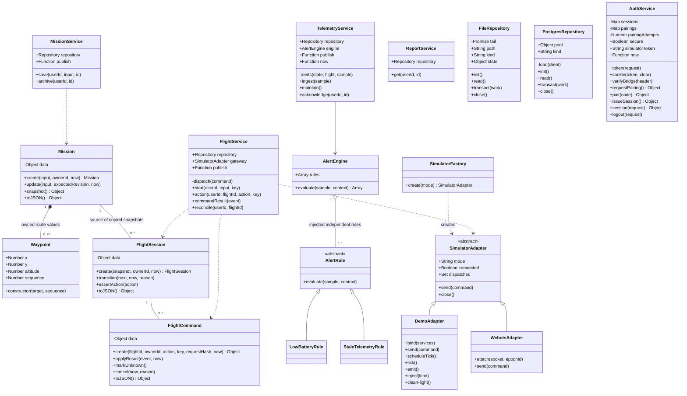
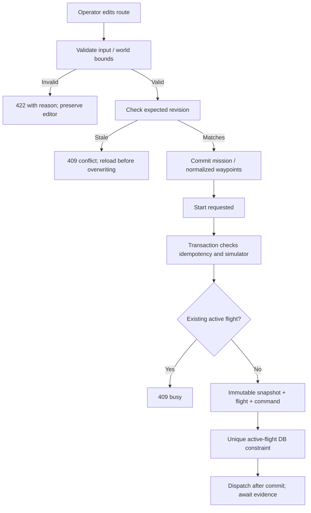
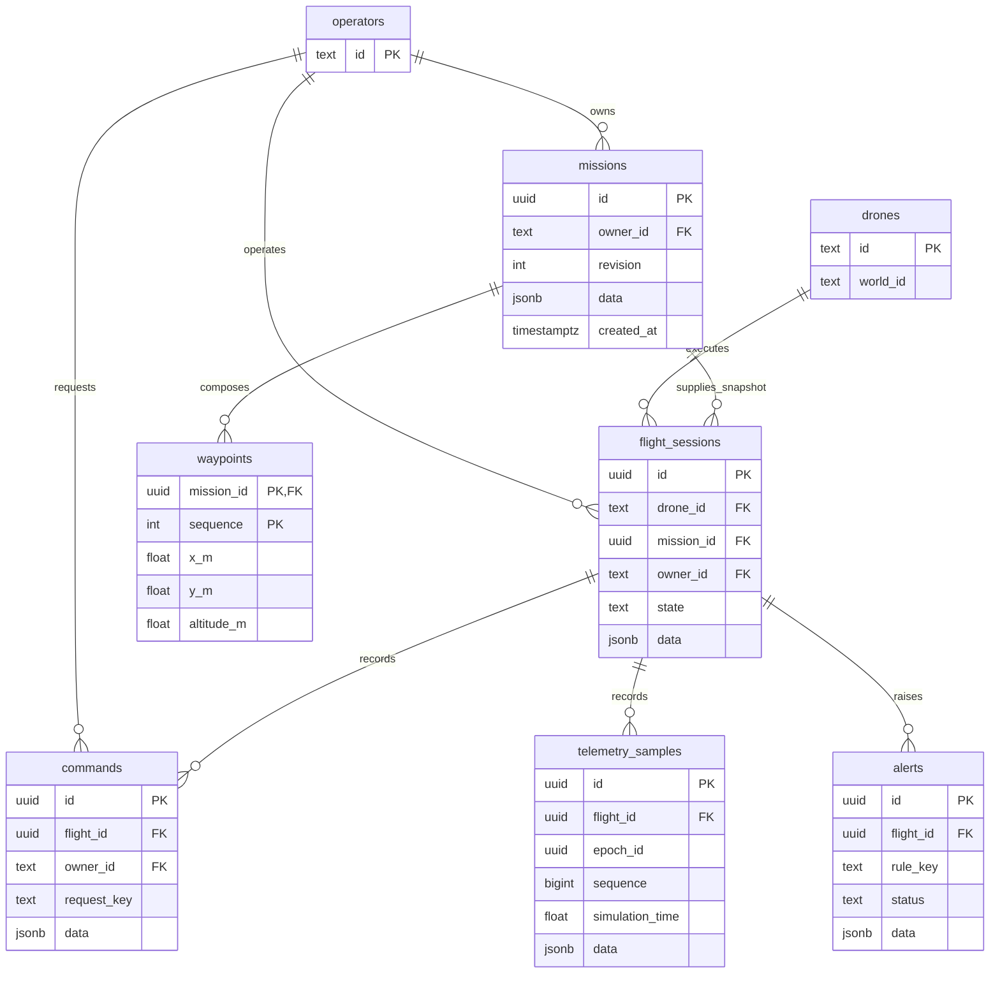

# Implemented design and evaluation guide

This is the as-built local dashboard/backend design. PRD.md and ENGINEERING.md include broader planned Webots requirements; this document distinguishes working application behaviour from pending integration. The delivery order is overridden by ADR-002, identity design by ADR-003.

## 1. Requirements and actors
Actor: a paired operator controlling the installation's one drone. Agent: demo adapter now, external Webots agent later. No login/signup or multi-tenant roles. Four-character bridge pairing replaces password-based entry.

| Use case | Requirement | Implemented behaviour |
|---|---|---|
| Pair control session | revised FR-01 | Single-use 2-minute alphanumeric code; long HttpOnly session; CSRF/origin checks |
| Plan mission | FR-02/03 | Click/drag local XY targets, edit altitude/order, save draft, revise, archive |
| Execute/control | FR-05/07/08/09 | Command records, acknowledged start/pause/resume/land through adapter; early land supersedes start |
| Monitor | FR-10/11 | Backend-generated demo telemetry, live snapshots, stale labels and scheduled freshness checks |
| Alert | FR-12 | Low battery/stale strategies, one incident per rule/flight, acknowledge/resolve |
| Review | FR-13/14 | Persisted history/snapshot, route/charts, command timeline, summary and JSON export |
| Integrate external agent | partial FR-04/06/15 | Authenticated socket transport/protocol test; actual Webots execution/reconciliation pending |

NFR targets in PRD remain measurement targets, not achieved latency claims. Embedded PostgreSQL verifies actual SQL/schema semantics; hosted Supabase and multi-client network concurrency need deployment evidence.

## 2. Actual class design


Snapshot, telemetry and alert records are validated plain value records, not separate claimed classes. Mission owns ordered waypoint values; flight owns a copied snapshot. Aggregation denotes injected alert strategies that can exist independently of the engine. Class object graph relationships are different from database cascade policy.

### Domain record attributes

| Class / record | Encapsulated or persisted attributes |
|---|---|
| Mission.#data | id, ownerId, revision, name, description, waypoints, worldId, frame, archived, createdAt, updatedAt |
| FlightSession.#data | id, droneId, ownerId, missionId, immutable snapshot, state, adapter, startedAt, endedAt, reason, latest telemetry |
| FlightCommand.#data | id, flightId, ownerId, action, requestKey, requestHash, status, createdAt, expiresAt, acceptedAt, completedAt, error |
| Telemetry value record | id, flightId, epochId, sequence, simulationTime, receivedAt, x/y/altitude, speed, battery/batterySource, roll/pitch/yaw, waypoint, state, optional reason |
| Alert value record | id, flightId, ruleKey, key, severity, title, message, status, createdAt, acknowledgedAt, optional resolvedAt |
| DemoAdapter runtime | epochId, queue, services, timer, flight, sample, pendingCommand; inherited mode/connected/lastSeen/dispatched |
| WebotsAdapter runtime | socket, epochId; inherited mode/connected/lastSeen/dispatched |

Async repository/service/transport methods return promises. Private helpers are implementation operations; record fields are not falsely presented as separate JavaScript classes.

## 3. OOP, SOLID and patterns in actual code
| Concept | Code evidence / reason |
|---|---|
| Encapsulation | Mission, FlightSession and FlightCommand keep private #data; state changes go through operations and exports are copies |
| Abstraction | SimulatorAdapter and documented repository port in application/ports.js isolate external concerns |
| Inheritance / polymorphism | AlertRule subclasses; DemoAdapter and WebotsAdapter implement the simulator contract |
| SRP | Domain invariants; MissionService use cases; ReportService calculations; AuthService identity; infrastructure persistence/transport |
| OCP | AlertEngine accepts strategies without changing its evaluation algorithm |
| LSP | Shared alert-rule contract tests; both repository implementations commit/rollback the same state contract. Physics/recovery capabilities are not claimed equivalent |
| ISP | Services consume only injected repository/gateway/publish operations, not HTTP/React APIs. Gateway surface remains small for this scope |
| DIP | Services accept collaborators in constructors; createRuntime wires infrastructure; domain imports no framework/database |
| Factory (creational) | SimulatorFactory selects exactly configured adapter; Webots mode never falls back to demo |
| Adapter (structural) | WebotsAdapter maps socket transport to send()/connection interface; File/Postgres repositories adapt storage to common unit-of-work contract |
| Command (behavioural) | FlightCommand is a first-class identified request with expiry/lifecycle/idempotency; transport/executor consumes serialized request |
| Strategy (behavioural) | LowBatteryRule and StaleTelemetryRule |
| Observer (behavioural) | EventEmitter distributes committed change notifications to authenticated browser subscriptions |

No Singleton or gratuitous inheritance. Database rows include domain snapshots for reproducible history. JavaScript JSDoc is documentation, not runtime interface enforcement; boundary schemas and tests enforce observable contracts.

## 4. Sequence: start and execute
```mermaid
sequenceDiagram
  actor Operator
  participant UI as React dashboard
  participant HTTP as Express controller
  participant Flight as FlightService
  participant Repo as Repository
  participant Adapter as SimulatorAdapter
  participant Telemetry as TelemetryService
  Operator->>UI: Start saved mission
  UI->>HTTP: POST /api/flights + CSRF + request key
  HTTP->>HTTP: Session and Zod validation
  HTTP->>Flight: start(principal,input,key)
  Flight->>Repo: Atomic idempotency/availability check + snapshot + command
  Repo-->>Flight: Committed request
  Flight->>Adapter: send(command)
  HTTP-->>UI: 202 pending request
  Adapter->>Flight: commandResult(ACCEPTED)
  Adapter->>Telemetry: ingest(TAKING_OFF)
  Telemetry->>Repo: Validate transition; persist readings/alerts
  Telemetry-->>UI: Committed snapshot via change observer / WS
  Adapter->>Telemetry: ingest(EXECUTING)
  Adapter->>Flight: commandResult(COMPLETED)
  Note over Adapter: Demo executes locally; real Webots controller remains pending
```

## 5. Activity: mission validation / concurrency


## 6. Implemented database schema


Source of truth is backend/migrations/001_initial.sql. Unique active-flight partial index prevents two ongoing flights per drone. Command owner/request-key uniqueness, telemetry flight/epoch/sequence uniqueness, waypoint composite PK, foreign keys and active-alert partial index enforce integrity. Waypoint rows update with mission revision in the same transaction. RLS prevents client Data API access without policies; backend performs operator checks as well.

PostgresRepository serializes writes with a transaction advisory lock for this one-drone scope, diffs aggregates before issuing parameterized upserts and reads consistent snapshots. Payload JSONB is deliberate to preserve complete immutable execution inputs; indexed relational fields support integrity. Current repository loads full state, so long-term/high-rate scaling requires paginated/incremental repositories. No scalability benchmark is claimed. FileRepository is atomic single-process demo storage only.

## 7. API/error contracts
See contracts/openapi.json for implemented REST operations and contracts/protocol.md for WebSocket/pairing details. Express controllers parse Zod schemas, call application services, map stable errors and return redacted unexpected errors with request IDs. No business rule is implemented only in React.

Important failures: 401 invalid/unpaired session; 403 origin/CSRF/disabled demo; 409 busy/revision/state/idempotency conflict; 422 invalid route; 503 agent offline. Timed-out requests become UNKNOWN, not rejected. Restart does not silently resume execution. Offline operator closure records INTERRUPTED without claiming landing.

## 8. Verification and remaining gates
Automated tests cover domain/state rules, code pairing and CSRF, mission revision/ownership, idempotent start, local concurrent starts, duplicate/out-of-order telemetry, alerts, demo command execution and early landing, rollback/reopen, actual SQL/schema semantics using embedded PostgreSQL, and external-agent WebSocket exchange using a test client.

Supabase session-pooler connection/migration and live write/read/rollback verification now pass (evidence/supabase-connection.md). Pending: real multi-connection PostgreSQL concurrency/load measurement, actual Webots model/controller and axis validation, loss-of-contact local landing and restart reconciliation in that controller, TLS hosted deployment, measured internet latency, finalized per-member contributions. Embedded PostgreSQL and test agent are explicitly not substitutes for those checks.

## 9. Rubric walkthrough
1. Present requirement/actor table and FR acceptance criteria.
2. Walk through actual classes above and explain multiplicities.
3. Show private state, immutable copies and real subclass substitutions.
4. Show SOLID table with corresponding classes and tests.
5. Explain why each implemented pattern solves a problem.
6. Follow actual start sequence and validation activity.
7. Show HTTP controller, service and repository boundaries; API/protocol docs.
8. Show SQL migrations, ER and constraint tests.
9. Demonstrate stale telemetry, offline start and conflicting revision/request key.
10. Run planner -> demo flight -> pause/resume/land -> alert -> saved report, clearly labelling demo; add actual Webots proof when integrated.

## Console UI revision
FlightConsole now owns instrument presentation and receives backend snapshots/callbacks from Workspace. A shared workspace theme covers the fixed navigation rail, mission library/editor, history/report, incidents and diagnostics. See ADR-004 and evidence/console-redesign.md. Domain/transport rules remain unchanged; demo timer ticks are coalesced so slow persistence cannot queue unlimited work ahead of commands.

## Webots world setup (2026-11-16)
Added training-ground-v1.wbt and the procedural `world_check` controller (no new domain classes or schema). One Mavic, 8 ms physics, ENU, fixed z=0 pad, 5 m grid, ±50 m boundary and matching non-colliding planner scenery. Actual Webots load and finite GPS/IMU/gyro readings verified, propellers held at zero. See ADR-005, simulator/README.md and evidence/phase-1.md. Backend Webots execution, flight control, dynamic axis validation and all flight-accuracy/recovery gates remain pending.

## Desktop viewport implementation (ADR-006)
`DesktopOnly` guards device/viewport support; `desktop-layout.css` bounds every
workspace page. `usePages` and `Pagination` page missions/flights/alerts/report
records. Planner renders the selected waypoint editor; Report uses section/metric
switches. Pure device-gate and pagination interaction tests cover these behaviors.

## Actual Webots executor (ADR-007)
`simulator/controllers/mission_control/mission_control.py`: `MissionController`
methods `command`, `sample`, `result`, `run`; module function `validate` enforces
execution boundary rules. Composes Robot/device handles, SQLite journal and
`BridgeTransport` (`send`, `run`) in transport.py. No network access in the motor
loop. Local active flights/accepted command IDs survive process restart, but
recovery is fail-closed and manual rather than automatic.

The earlier external-agent-only and pending-controller descriptions above describe
the baseline before ADR-007. Actual local evidence now lives in
evidence/webots-integration.md. Generated 2 Hz readings are storage-throttled using
telemetry_ack; heartbeat acknowledgement is no longer a persistence barrier.

## FR-16 camera implementation (ADR-008)
Python `CameraStream` owns `frames: Queue(1)`, `dropped`, injected `BridgeTransport`;
methods `offer(image,width,height,simulation_time)` and `run()`. MissionController
composes 1 CameraStream and 1 Webots Camera. No new inheritance or domain pattern
was introduced. Backend module `createCameraChannel(context)` returns transport
`upgrade`/`close` operations; `validateFrame` enforces image envelope/header bounds.
React `CameraFeed({enabled})` owns media subscription/freshness display and is
composed by FlightConsole. Boundary tests exercise authorization, epoch fencing,
JPEG dimensions/order, revocation, immutable latest-only queue and stale UI states.
Actual images/flight evidence: evidence/camera-integration.md.

## Textured yard (ADR-009)
`simulator/assets/training-yard.jpg` is generated by
`simulator/tools/build_yard_texture.py` using the pinned Pillow dependency. World
uses one non-colliding textured surface above the existing ground collider. Origin
H, planner footprints and axis mapping preserved; additional pads/lanes are paint.
This replaces the earlier uniform floor/5 m geometric grid description. See
`evidence/textured-yard.md` for actual simulator/camera verification.

## Canonical planner and scaled pads (ADR-010)
`shared/worlds/training-ground-v1.json` and training-yard.jpg replace independent
planner scenery and simulator/assets texture. WorldMap imports that exact JPEG;
`frontend/src/lib/world-map.js` maps ±60 m surface to 600 SVG units, validates ±50 m
flight clicks. Origin stays (300,300); +Y is up. Backend WORLD imports shared IDs /
flight bounds. Home pad 1.5 m and others 1.2 m diameter; 4× zoom and real SVG scale.
See evidence/canonical-map.md. This supersedes earlier schematic/pad-size statements.

## Simultaneous flight views (ADR-011)

`FlightConsole` presents map, `CameraFeed`, large altitude/speed/battery/time readings and attitude concurrently. The camera viewer now mounts for the overview lifetime. Existing command guards are retained. Altitude history is always visible below; no additional flight capability is implied. Workflow coverage verifies concurrent panels and absent telemetry, route toggle and takeoff command guards.

### Flight-deck chrome and zoom

Overview hides shared topbar/footer and uses a single Flight deck heading. Drone title uses `data.drone.id` (stable drone code, not the expiring pairing secret). Map is square; panel radius reduced to 8px. Explicit `WorldMap.zoomKey` opts the flight-deck map into tab-session zoom retention across remounts; reset clears the current zoom to full extent. Optional browser storage failure falls back to local state. No API or schema change.

Map interaction: non-compact maps consume non-passive wheel events for exponential zoom (1×–4×), including Chromium trackpad pinch events (`ctrlKey`). Delta modes are normalized, gestures do not scroll the page, keyed map zoom persists and reset remains available. Listener is removed on unmount. Wheel/pinch bounds and prevented scrolling covered by frontend test; 15 frontend tests, lint/build pass.

Map presentation refinement: the flight-deck map is labelled Map. One horizontal tray holds status, route visibility, zoom and reset controls, using Layers/Zoom/Scan icons. Status distinguishes active, paused, stale/offline and standby, with current state and color legend on hover or keyboard focus. Removed the mission-preview badge and route-name overlay. Lint, 15 frontend tests and build pass; browser screenshot: docs/evidence/screenshots/desktop/map-tray.png. The bridge is currently offline after backend restart; no live-flight evidence claimed for this UI check.

Removed decorative desktop-gate tagline, workspace footer, page eyebrows, map environment caption, mission/control micro-headings and redundant camera/chart/local-frame labels. Functional labels, units, input guidance, status/failure messages and explicit demo provenance remain. Lint, 15 frontend tests and build passed before the final title typography CSS adjustment.

## Operator instruments and route heading (ADR-012)

Flight deck emphasizes numeric altitude, ground speed, elapsed simulation flight time, waypoint, measured attitude, local X/Y and bearing. Battery remains explicitly estimated; connection and stale telemetry remain separate from flight state. Compass uses a rotating local-axis rose with fixed aircraft pointer and local bearing, plus missing/stale indication. `angle_error` and `next_heading` provide bounded route-facing yaw in the Webots control loop. No new API/schema or network operation in the physics loop.

Checks: 16 frontend tests, 7 Python tests, lint/build pass. Real flight report: docs/evidence/webots/bff4a933-ae80-41f9-81c9-f14549583255.json. UI screenshot: docs/evidence/screenshots/desktop/operator-instruments.png (standby; no numeric telemetry fabricated). All six panels fit at 1101×652 CSS pixels without overflow.

## Fixed display identity and explicit route selection

`shared/config/drone.json` assigns this installation the public four-letter display identity BMBL, separate from internal drone-01 and expiring pairing credentials. Dashboard returns `drone.code`. This is a single-installation identity, not multi-drone support or a permanent authentication code. Persistent browser pairing across server restart is still outstanding.

MissionCards now exposes Select, which records a selected mission ID in Workspace without starting flight. FlightConsole displays only that selected route or an active immutable flight snapshot; it no longer implicitly chooses the first saved mission. The route visibility toggle is removed. Circular-arrow reset, wheel/pinch zoom and retained map zoom remain.

Camera is a 16:9 panel labelled Camera; heading, pitch and roll moved into the right parameter panel. Live badge is suppressed for the clean camera view; unavailable/stale states remain visible. Altitude chart is below the camera and the compass is on the lower row. Backend 28 and frontend 17 tests, lint/build passed. A prior browser screenshot verified the revised layout; latest continuation could not reconnect because the local preview server was stopped.

## Permanent installation code correction (ADR-014)

Explicit user direction supersedes earlier temporary-code requirements: this local installation uses permanent code BMBL from shared/config/drone.json. Pairing code does not expire or get consumed. Claims remain rate-limited and issue random protected browser sessions; bridge credentials remain separate. Other deployments configure their own distinct code. No multi-drone backend or durable browser-session storage is claimed. Full lint, backend28/frontend17 tests and production build pass.

Flight-deck visual-row adjustment: square map and camera occupy the top row; parameter card and altitude trend move below with mission controls. Heading remains as a compact numeric/position panel below. Camera expands across the right two columns. No telemetry or command contract changes. Lint, 17 frontend tests and build passed for this CSS layout change; final compact heading CSS is presentation-only.

Altitude instrument layout: primary row uses matched square map dimensions, a narrower camera and a separate vertical altitude gauge. Gauge uses measured altitude against configured world maximum (clamped visual fill, raw value retained); missing and stale states remain explicit. Shared grid gap is 14px or 12px on short desktops. Parameters and history align underneath. Lint, frontend17 and build passed before final square-grid CSS sizing refinement.

Selected mission card: shows explicit selected/in-flight state, mission name and waypoint table (X/Y/altitude in metres), two rows per page without scrolling. Start invokes existing Workspace start service with the selected mission/revision; disabled offline, busy, pending or empty route. Change mission remains available before flight. Plan mission is a high-contrast filled action. Frontend18 tests, lint/build pass; selected-plan test verifies details and exact mission passed to Start.

Connection/error banners now render as one deduplicated, dismissible fixed notification outside content flow. Connection notification remains until dismissed or recovered; new error/connection state remounts its notice. Action toasts stack in the same overlay. No flight-state or freshness guards changed. Frontend19 tests (including failure dismissal and no in-flow banners), lint/build pass.

## Telemetry card presentation refinement (2026-11-16)

FlightConsole groups installation identity and reported flight state in a compact
header, estimated battery in an inset strip, four primary measurements in divided
columns and measured attitude in a secondary row. Connection/freshness text is
visible beneath the readings; stale values receive muted amber styling. Missing
values remain dashes. FR-10/FR-11 presentation only; no API, schema, architecture
or command changes. Lint, all 19 frontend tests and production build pass.
Live browser geometry and simulator acceptance were not re-run for this styling
change.

Telemetry section now groups eight parameter tiles (battery estimate, altitude, speed, flight time, waypoint, heading, pitch, roll) into two rows of four. UAV identity is header-left and state/freshness header-right. This section and altitude history use a 3:2 nested grid, independent of the camera/map row. Missing telemetry remains a dash; stale values are styled. Frontend19 tests, lint/build pass.

Initial display refinement: no-sample altitude history shows an empty grid/axes without invented points. Before an active flight, parameter tiles show zero defaults with units, flight time 00:00 and waypoint 0/count. These are UI defaults, not measured readings; active-flight missing values remain dashes. Tile labels enlarged and semibold. Frontend19 tests, lint/build pass.

Visual consistency refinement: removed overview title/toolbar; all CSS border-radius declarations reference shared --radius:8px, including chart tooltip. Altitude range bar replaced by vertical ruler with 16 ticks, five-step labels, clamped position marker, raw numeric height and configured limit. Missing/stale messaging retained. Lint, frontend19 tests and build pass.

Navigation stack: circular compass is visible above altitude ruler in the right-hand primary column. Rose uses N/E/S/W with local north defined as +Y (unchanged local bearing convention), measured yaw and missing/stale handling retained. Icon rail reduced to 60px with matched content offset. Shared panel gap/radius retained. Lint, frontend19 tests and build pass.

Compass visibility fix: removed obsolete high-specificity display:none rule on compass body; stack explicitly renders SVG with bounded dimensions. Removed surrounding card background, border and shadow. Browser verified compass visible above altitude ruler; screenshot docs/evidence/screenshots/desktop/compass-visible.png. Existing measured yaw rotation unchanged. Lint, frontend19 tests and build pass. Simulator offline during visual check; no live rotation claim.

Navigation rail proportion refinement: column reduced from 155/140px to 120/108px, compass row bounded at 116/98px and remaining height assigned to altitude ruler. Camera automatically receives recovered width. Lint, frontend19 tests and build pass.

Altitude history axes: empty chart now includes numeric ticks and explicit Time (s)/Altitude (m) labels (0–60s, 0–15m initial display only, no data points). Live Recharts axes reserve label margins and show the same units; battery charts use %. Frontend19 tests, lint/build pass.

Mission planner workspace: saved route tiles and editor remain side by side. Library pages four map/title tiles; tile click selects plan and returns to overview without starting flight. Edit and archive icon buttons overlay each image, independent of selection; archive retains existing confirmation and saved flight history. Right editor supports new/edit, waypoint picking/dragging, bounded coordinate/altitude inputs, reordering and save with revision. Browser verified combined planner composition; screenshot docs/evidence/screenshots/desktop/mission-workspace.png. Frontend20 tests include independent tile/edit/archive behavior; lint/build pass.

Planner chrome cleanup: shared topbar, back action, editor title/subtitle and map header removed; Save remains a visible toolbar action. Removed LOCAL XY, bounds/draft footnotes and map footer/compass. Horizontal zoom/reset tray matches flight deck. Input bounds and validation unchanged. Frontend20 tests passed before title-only removal; final lint/build pass.

Planner detail arrangement: square route map and compact details strip share the same constrained width; details occupy the next grid row, waypoint editing remains alongside. Details use name/default-altitude in one row and description below, with no numbered header or fixed empty panel height. Frontend20, lint/build passed before final grid-row alignment CSS; no form validation changes.

Planner proportion refinement: library/editor 4:6, square complete map previews (no slice crop), details reduced to title/default altitude with dashboard-style inputs. Description editing removed; existing persisted descriptions remain backend-compatible. Default speed is explicitly disabled as Controller managed because configurable cruise speed has no execution contract yet; not presented as implemented. Frontend20 tests, lint/build pass.

Planner alignment correction: map/details stretch to their shared grid column (no independent centering/width cap), with one 14px gap token (12px on compact desktops) between grid panels and save toolbar. Save matches waypoint column width. Square map retained. Lint, frontend20 and build pass.

Planner overlap fix: explicit map-size grid row and reserved 145px details row keep form separate and visible; map SVG is bounded absolutely within square panel. Browser verified at1280x720: square483px, gap14px, form bottom708px within viewport. Screenshot docs/evidence/screenshots/desktop/planner-inputs-fixed.png. Frontend20/lint/build pass.

Waypoint UI now uses ordered list rows (three per page) with X/Y/altitude editors, reorder and remove controls. Removed 03 heading prefix. Map selection moves to corresponding list page; bounded paging retains no-scroll requirement. Frontend20, lint/build pass.

User-directed scrolling exception: planner waypoint list now renders all waypoints (max20) in one vertically scrollable bounded panel, replacing pagination. New/map-selected waypoint is revealed within the list without scrolling the page. Overall workspace remains fixed; this explicitly supersedes the no-scroll requirement for waypoint contents only. Lint/frontend20/build passed before final selection-reveal enhancement.

Planner form clipping correction: reserved158px form row and additional viewport safety space before computing square map size. Details use16px internal padding, equal row/column spacing, aligned units and bounded34px inputs. Map and form retain equal width. Frontend20/lint/build pass.

User-directed library scrolling: saved missions render all entries in two columns with8px tile gap matching telemetry tiles. Filter UI and pagination removed. Only library contents scroll; overall workspace stays bounded. Editor grid stretches to shared bottom baseline with details bottom-aligned and waypoint panel spanning both rows. Frontend20 tests updated for all records without paging; lint/build pass.

Map route legibility: planned route uses continuous lavender line with dark casing and non-scaling strokes, direction chevrons per leg, opaque high-contrast waypoint circles and larger compact-preview numbering. Selected points have filled highlight. Canonical coordinates and route geometry unchanged; recorded trail remains distinct. Frontend20/lint/build pass.

Waypoint rows refined with compact index selector, up/down reorder, red remove action and aligned X/Y/Alt metre inputs; selected row remains highlighted. Global scrollbar chrome hidden while authorized list scrolling remains enabled. Frontend20/lint/build pass before invalid-color literal cleanup.

Default/per-leg speed implemented per ADR-015. Planner stores speed on every waypoint, with default controls; old saved routes normalize to1m/s. Database migration002 applied locally, SQL repository writes normalized speed and mission JSON. Controller caps desired velocity magnitude and slows near target. Waypoint coordinates/speed are inline label-input-unit pairs across two compact rows, reorder/delete share tray. Python8 tests; backend29/frontend20 tests and lint pass. Build passed after removing a dangling import of absent light-theme.css from a parallel working-tree change.

Real speed-flight check passed: docs/evidence/webots/bd8ed048-ede6-4384-ac5b-13624e7e3bbd.json, snapshot speed0.5m/s, all four commands COMPLETED, upright/hover checks passed. Actual speed below requested cap (max0.2373m/s) on this conservative short trial; exact tracking and multi-leg transitions remain qualification limits.

## Site-wide appearance (ADR-015)

`ThemeToggle` applies a document-level light/dark preference through `lib/theme.js`;
light is the default and localStorage retains the selection across reloads.
`light-theme.css` covers all screens and shared surfaces; chart colors use CSS
variables. Sidebar bottom holds the toggle, with session disconnect relocated to
System. No API/schema or domain changes. Frontend coverage checks persistence,
blocked storage and navigation placement. Browser checked pairing, overview,
planner, history/report, alerts and System, including a reload in dark mode.
Evidence: `evidence/screenshots/desktop/light-theme.jpg`. No flight command issued.

Flight history redesign: removed shared topbar, redundant page subtitle/date and numbered table header. Dedicated title/count, three summary tiles and scrollable record rows emphasize mission name/date, measured session duration, state and report. Demo provenance remains explicit. Removed ID/revision microcopy and pagination from this screen. Frontend24/lint/build pass.

Flight report visual redesign: mission/date header without ID/eyebrow clutter, readable metric tiles, simple overview/commands/incidents tabs, map/chart panels and download action. Removed dense sample-count footer, preserving explicit incomplete/gap warnings and estimated battery label/demo provenance. Commands/incidents scroll inside report rather than paginate. Command errors remain visible. Frontend24/lint/build pass.

Six predefined mission plans: Straight line, Square, Zigzag, Circular, Toroidal up/down. Last two are ascending/descending two-turn helical approximations,20 points,3–11m. All routes fit local bounds, speed0.5m/s. Shared generator shared/mission-templates.js and repeat-safe name-skipping seed script scripts/seed-mission-templates.js. Saved into actual mission repository through authenticated APIs; editable/selectable like other plans. No automatic flight triggered. Frontend25/lint/build pass; routes have not individually passed physics qualification.

System and Alerts merged into one System & alerts sidebar destination. Health tiles show UAV, simulator link, dashboard channel and open incidents; incident list retains acknowledgement and messages; connection details and labelled demo controls remain. Removed old connection diagram, numbered headings and outdated unverified claim. Selected waypoint summary table now uses readable sans-serif text, larger row values and explicit light/dark header/row contrasts. Frontend25/lint/build pass.
